# 300-10 Đặc tả Nhận thức Tĩnh (Bản rút gọn cho Thị trường Nước ngoài) v3.2.1

> **Tài liệu bổ trợ nội bộ:** Xem mục lục giải thích trực quan các thuật ngữ dễ nhầm trong thư mục [`huong-dan-thuat-ngu/`](huong-dan-thuat-ngu/README.md).

## Lịch sử sửa đổi phiên bản

| Phiên bản | Thời gian | Người biên soạn | Nội dung sửa đổi |
| :--- | :--- | :--- | :--- |
| **V2.0** | 2026/04/02 | Hạ Hàm (夏晗), Cẩu Tân Siêu (苟新超), Lưu Hy Nghiêu (刘希尧), Vương Bằng Hâm (王鹏鑫) | Tái cấu trúc và rút gọn quy chuẩn gán nhãn dựa trên tài liệu *《300 - Quy chuẩn gán nhãn cấu trúc đường tĩnh BEV và biển báo mặt đường của Viện Công nghệ Mới BYD - V1.5.13》* |
| **V2.1** | 2026/04/20 | Trần Tinh Vũ (陈星宇) | Bổ sung loại tâm làn khu vực không vạch (`wireless/lineless area`) trong `lane`; chỉnh sửa quy tắc gán nhãn kịch bản biến đổi N sang M qua khu vực không vạch tại mục 2.1.1 |
| **V2.2** | 2026/05/29 | Tề Tiểu Khang (齐小康), Vương Bằng Hâm (王鹏鑫) | Bổ sung loại tâm làn khu vực không vạch trước trạm thu phí trong `lane`; chỉnh sửa nhấn mạnh loại tâm làn trước trạm thu phí trong quy tắc gán nhãn kịch bản trạm thu phí |
| **V3.0** | 2026/06/09 | Mão Siêu (茆超), Diêm Thủ Chí (阎守志), Liên Húc Thăng (连旭升) | Bổ sung quy tắc gán nhãn chỗ đỗ xe (`slot`): thêm mới mục 1.6 và mục 2.1.6 |
| **V3.1** | 2026/06/25 | Trương Chí Cường (张志强), Tề Tiểu Khang (齐小康), Cừu Tuấn Dương (仇峻阳), Lưu Hy Nghiêu (刘希尧), Vương Bằng Hâm (王鹏鑫) | Bổ sung 4 quy tắc gán nhãn theo kịch bản: • 2.8 Quy tắc gán nhãn khu vực chờ • 2.9 Quy tắc gán nhãn đường chính – phụ không hướng, không vạch • 2.10 Quy tắc gán nhãn đường cấp thấp • 2.11 Quy tắc gán nhãn khu vực thi công |
| **V3.2** | 2026/06/26 | Hạ Hàm (夏晗), Vương Bằng Hâm (王鹏鑫) | Bổ sung 2 loại `roadmarker` trong mục 1.5: • `22` Mặt nút giao chữ T • `23` Mặt nút giao vòng xuyến |
| **V3.2.1** | 2026/07/07 | Hạ Hàm (夏晗), Hàn Vũ (韩雨) | Bổ sung thêm các loại `roadmarker` trong mục 1.5: • `24` Khu vực xe phi cơ giới màu đỏ • `25` Mũi tên vòng xuyến chếch trái • `26` Mũi tên vòng xuyến chếch phải • `27` Đi thẳng nhường xe rẽ phải Bổ sung giải thích kịch bản vạch qua đường (ngựa vằn) |

---

## Quy tắc chung về gán nhãn (标注总则)

*(Áp dụng thống nhất xuyên suốt toàn bộ đặc tả bên dưới; các nội dung được đánh dấu 🔴 thuộc trách nhiệm phía tích hợp dữ liệu.)*

---

## 1. Phương thức mô tả cấu trúc đường

Các phần tử ground-truth tĩnh (static GT elements) bao gồm 5 loại: **`Lane`** (Đường tâm làn), **`Border`** (Vạch làn / biên làn), **`Roadedge`** (Mép đường / lề đường), **`stopline`** (Vạch dừng) và **`Roadmarker`** (Ký hiệu / biển báo mặt đường). Trong đó, `Lane`, `Border`, `Roadedge` và `stopline` được gán nhãn dưới dạng **đường (polyline)**; còn `Roadmarker` được gán nhãn dưới dạng **khung chữ nhật bao ngoài (outer bounding rectangle)** hoặc **đa giác (polygon)**, và không thực hiện ràng buộc quan hệ giữa các phần tử với nhau.

> **[🔴 QUY TẮC PHÂN BIỆT VAI TRÒ]** Các nội dung được gắn nhãn **🔴 XỬ LÝ PHÍA TÍCH HỢP** tương ứng với **nền đỏ** trong tài liệu gốc (do phía tích hợp hệ thống xử lý); toàn bộ các nội dung còn lại là **quy chuẩn gán nhãn thủ công**.

- Bảng cấu hình quy tắc gán nhãn *(tài liệu tham chiếu nội bộ trong bản gốc)*: `4D静态感知规格简化版配置表` (Bảng cấu hình bản rút gọn đặc tả nhận thức tĩnh 4D)
- Tài liệu quy tắc kiểm tra chất lượng khung đơn *(tài liệu tham chiếu nội bộ trong bản gốc)*: `4D标注单帧质检标准` (Tiêu chuẩn QA khung đơn gán nhãn 4D)

---

### 1.1 `Lane` —— Nội dung gán nhãn đường tâm làn

**Định nghĩa:** Đường tâm làn là đường nối **ảo** dùng để biểu diễn vị trí chính giữa làn đường, thể hiện hướng đi của làn và mối quan hệ kết nối giữa các làn với nhau.

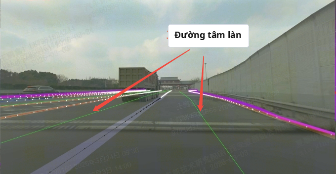

Chi tiết nội dung gán nhãn đường tâm làn xem tại **Bảng 1**.

#### Bảng 1: Nội dung và mô tả gán nhãn `Lane`

| Nội dung gán nhãn | Mô tả | Miền giá trị | Mô tả loại | Hình minh họa |
| :--- | :--- | :--- | :--- | :--- |
| `lane_id` | ID của đường tâm làn | `[0, +∞)` | ID tăng dần bắt đầu từ `0` | — |
| `direction` | Hướng của làn đường (làn một chiều / làn hai chiều) | `0` | Một chiều (单向) | — |
| `direction` | Hướng của làn đường | `1` | Hai chiều (双向) | — |
| `type` | Loại làn đường | `0` | Làn thường (普通车道) | — |
| `type` | Loại làn đường | `1` | **Làn thủy triều** (潮汐车道 — đoạn đường có thể thay đổi hướng xe chạy tùy lưu lượng giao thông, thường cấu tạo bởi hai cặp vạch nét đứt màu vàng song song; xem thêm [giải thích chi tiết](huong-dan-thuat-ngu/lan-thuy-trieu.md)) | 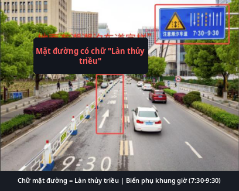 |
| `type` | Loại làn đường | `2` | **Làn biến đổi** (可变车道 — làn có thể thay đổi hướng chỉ dẫn bất cứ lúc nào theo lưu lượng giao thông) | 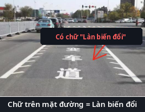 |
| `type` | Loại làn đường | `3` | **Làn khẩn cấp** (应急车道 — làn dành cho xe chạy hoặc dừng đỗ trong trường hợp khẩn cấp) | 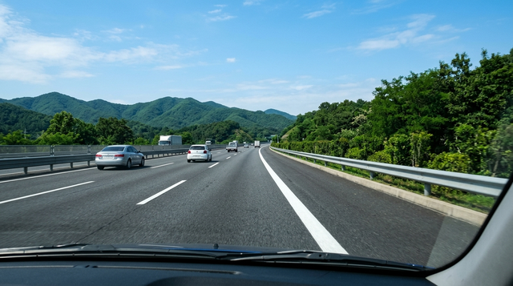 *(Hình minh họa bổ sung cho ô trống trong tài liệu gốc)* |
| `type` | Loại làn đường | `4` | **Làn xe phi cơ giới** (非机动车道 — làn dành riêng cho xe phi cơ giới và xe máy lưu thông) | 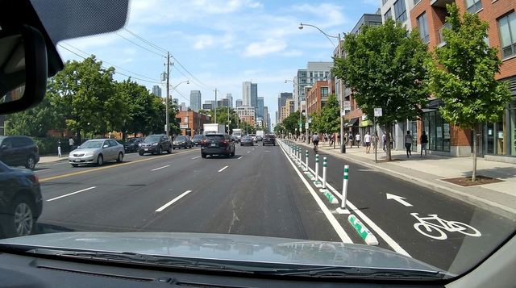 *(Hình minh họa bổ sung cho ô trống trong tài liệu gốc)* |
| `type` | Loại làn đường | `5` | **Làn dành riêng cho xe buýt** (公交专用车道 — làn có quyền lưu thông độc lập dành riêng cho xe buýt) | 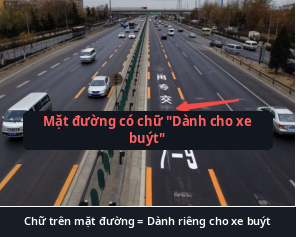 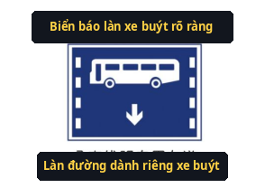 *Có biển báo làn xe buýt rõ ràng — Làn dành riêng cho tuyến xe buýt* |
| `type` | Loại làn đường | `6` | Làn chờ (等待车道) | — |
| `type` | Loại làn đường | `7` | Làn khu vực không vạch (无线区域车道) | — |
| `type` | Loại làn đường | `8` | Làn khu vực không vạch trước trạm thu phí (收费站前无线区域车道) | — |
| `type` | Loại làn đường | `99` | Khác (其它) | — |
| `Points` | Tập điểm của đường tâm làn | Mảng `[(x, y, z)]` | **Đảm bảo thứ tự điểm khớp với hướng xe chạy** | — |

---

### 1.2 `Border` —— Nội dung gán nhãn vạch làn đường

**Định nghĩa:** Vạch làn đường là các vạch kẻ **tồn tại thực tế** trên mặt đường dùng để phân định làn xe chạy và tách các luồng giao thông ngược chiều; thường dùng vạch nét đứt và nét liền để thể hiện khả năng cho phép đè/vượt vạch.

Chi tiết nội dung gán nhãn vạch làn xem tại **Bảng 2**.

> **[🔴 XỬ LÝ PHÍA TÍCH HỢP]** Các loại vạch kép *(khoảng cách giữa các vạch `< 30 cm`)* / vạch ba *(khoảng cách giữa các vạch `< 25 cm`)* / vạch bốn *(khoảng cách giữa các vạch `< 25 cm`)* cần được **phía tích hợp ánh xạ lại (remap)**: `101` = trái liền phải đứt, `102` = trái đứt phải liền, `103` = hai vạch liền, `104` = hai vạch đứt; vạch ba (`105`) và vạch bốn (`106`) đều được ánh xạ thành **vạch liền**.

#### Bảng 2: Nội dung và mô tả gán nhãn `Border`

| Nội dung gán nhãn | Mô tả | Miền giá trị | Mô tả loại | Hình minh họa |
| :--- | :--- | :--- | :--- | :--- |
| `border_id` | ID của vạch làn | `[0, +∞)` | ID tăng dần bắt đầu từ `0` | — |
| `direction` | Hướng của vạch làn | `0` | **Một chiều** (Hướng của vạch làn trùng với hướng vẽ vạch làn) | 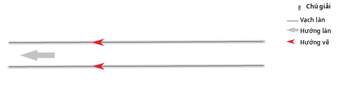 |
| `direction` | Hướng của vạch làn | `1` | **Hai chiều** (Thường dùng để phân cách hai chiều xe ngược nhau) | 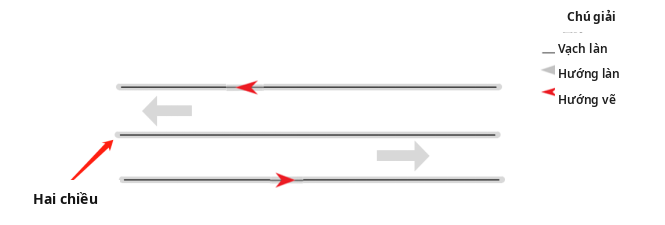 |
| `type` | Loại vạch làn | `0` | **Nét đứt** (虚线 — vạch làn nét đứt thông thường) | 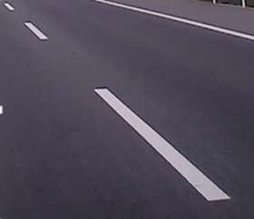 |
| `type` | Loại vạch làn | `1` | **Nét liền** (实线 — vạch làn nét liền thông thường) |  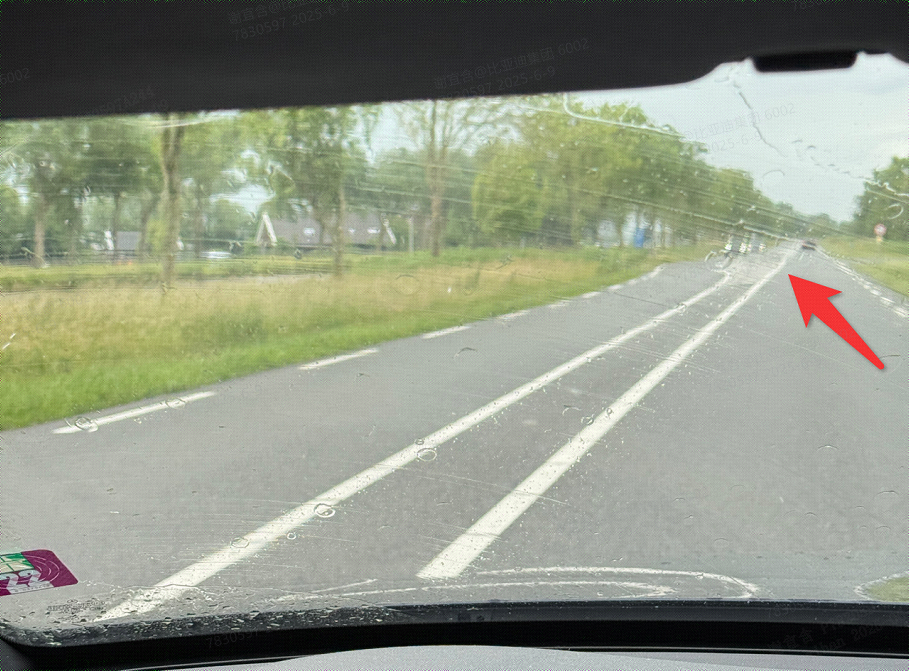 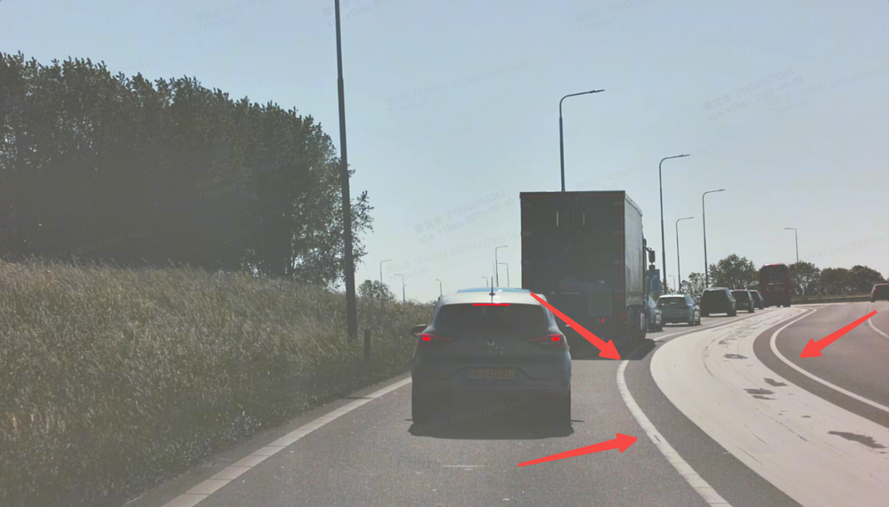 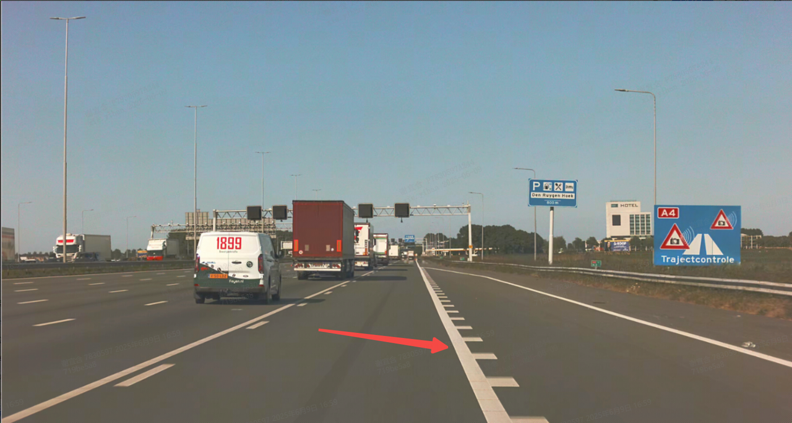 |
| `type` | Loại vạch làn | `2` | **Vạch dẫn hướng nút giao** (路口引导线 — tương tự vạch khu chờ, đều là phần kéo dài của vạch làn tại ngã tư; điểm khác biệt là vạch này kéo dài tới tận vạch làn mới sau nút giao) | 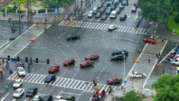 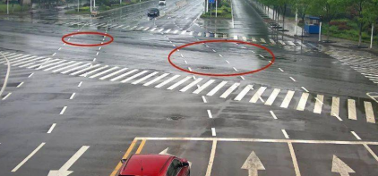 |
| `type` | Loại vạch làn | `3` | **Vạch khu chờ tại nút giao** (路口待行区线 — đại đa số là khu chờ rẽ trái, ngoài ra cũng có một phần là khu chờ đi thẳng và khu chờ rẽ phải) | 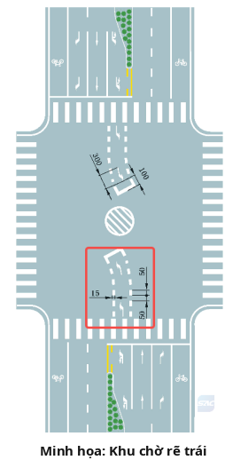 |
| `type` | Loại vạch làn | `4` | **Vạch giảm tốc dọc** (纵向减速线 — chỉ riêng các vạch cấu tạo bởi hình tứ giác ở hai bên vạch làn trên đường trên cao / cao tốc; là một cặp vạch nét đứt hình thoi song song với vạch phân làn, tạo cảm giác thị giác làn bị thu hẹp để nhắc tài xế giảm tốc độ) | 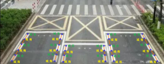 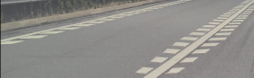 |
| `type` | Loại vạch làn | `5` | **Vạch cũ / vạch bỏ qua** (旧线 / 忽略线 — chủ yếu là các vạch dễ gây nhầm lẫn do dấu vết vạch cũ, vết cào xước... Cần gán nhãn riêng và gán thuộc tính là vạch bỏ qua. Khi thi công cải tạo làn đường, vạch cũ gán là vạch bỏ qua) | 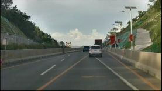 *Trong hình: vạch vàng là vạch mới, vạch trắng là vạch cũ (phải gán là vạch cũ)* |
| `type` | Loại vạch làn | `99` | **Khác** (其它 — chọn khi một vạch làn nào đó không thể xếp vào các loại trên) | — |
| `color` | Màu của vạch làn | `0` `1` `2` `3` `4` `99` | `0`: Trắng `1`: Vàng `2`: Đỏ `3`: Xanh dương `4`: Xanh lá `99`: Không thể nhận diện | 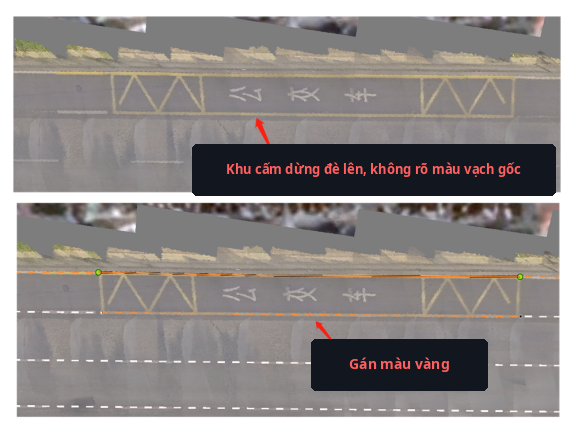 *Với vạch làn tại vị trí bị khu vực cấm dừng đè lên: nếu bị đè kín hoàn toàn không thể nhận biết màu vạch gốc thì gán theo màu của khu vực cấm dừng.* |
| `points` | Tập điểm của vạch làn `[(x, y, z)]` | — | **Đảm bảo thứ tự điểm khớp với hướng xe chạy** | — |
| `width` | Độ rộng vạch làn | `0` | **Nét mảnh** (细线 — độ rộng vạch `< 20 cm`) | — |
| `width` | Độ rộng vạch làn | `1` | **Nét dày** (粗线 — độ rộng vạch `> 20 cm`) | — |

---

### 1.3 `Roadedge` —— Nội dung gán nhãn mép đường

**Định nghĩa:** Dùng để xác định vùng có thể lưu thông của tuyến đường, thường chỉ ranh giới vật lý thực tế của đường tạo thành bởi bó vỉa, hộ lan/lan can, khối bê tông..., là ranh giới có sự thay đổi về cao độ hoặc vật liệu mặt đường.

Chi tiết nội dung gán nhãn mép đường xem tại **Bảng 3**.

#### Bảng 3: Nội dung và mô tả gán nhãn `Roadedge`

| Nội dung gán nhãn | Mô tả | Miền giá trị | Mô tả loại | Hình minh họa |
| :--- | :--- | :--- | :--- | :--- |
| `road_edge_id` | ID của mép đường | `[0, +∞)` | ID tăng dần bắt đầu từ `0` | — |
| `type` | Loại mép đường | `0` | **Mép đường phẳng (`boundary`)** **Không có thay đổi đột ngột về cao độ, có sự thay đổi vật liệu mặt đường và là ranh giới không nên chạy đè qua**; ví dụ ranh giới giữa mặt đường nhựa và nền đất/bãi cỏ (thường gặp ở quốc lộ, đường nông thôn); ranh giới phẳng giữa mặt nhựa và mặt xi măng cho phép đi qua thì **không** tính là mép đường phẳng. | 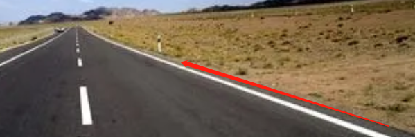 |
| `type` | Loại mép đường | `1` | **Mép đường có thay đổi cao độ** Hàng rào/lan can (`fence`), bó vỉa đá cao, cột phân làn (`traffic_column`), rào chắn nước (`water_horse`) và các loại mép đường có chênh lệch cao độ khác. |   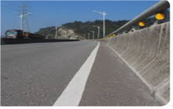 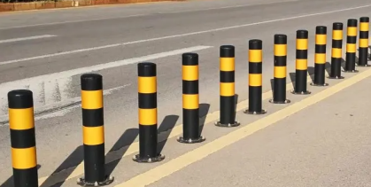 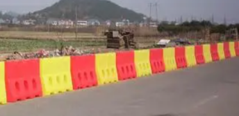   *(Lưu ý hướng của mép đường)* |
| `type` | Loại mép đường | `99` | **Khác** (其它 — chọn khi không thể xếp vào các loại trên) | — |
| `points` | Tập điểm của mép đường `[(x, y, z)]` | — | **Đảm bảo thứ tự điểm khớp với hướng xe chạy (cùng chiều làn bên cạnh)** | — |

---

### 1.4 `Stopline` —— Nội dung gán nhãn vạch dừng

**Định nghĩa:** Vạch dừng là vạch liền màu trắng kẻ ngang trước chiều xe chạy tại nút giao / đoạn đường, biểu thị vị trí xe phải chờ tín hiệu cho phép đi, đồng thời không được vượt quá hoặc đè lên vạch dừng.

Chi tiết nội dung gán nhãn vạch dừng xem tại **Bảng 4**.

- Lưu ý tô màu trong bảng gốc: `🟩` Chỉ đánh dấu ô được tô nền xanh lá trong tài liệu PDF gốc; phần tử `Stopline` vẫn luôn gán nhãn dạng **đoạn thẳng** (riêng `type = 2` vẽ **1 đường tại cạnh đáy của tam giác**).

#### Bảng 4: Nội dung và mô tả gán nhãn `Stopline`

| Nội dung gán nhãn | Mô tả | Miền giá trị | Mô tả loại | Hình minh họa |
| :--- | :--- | :--- | :--- | :--- |
| `stopline_id` | ID của vạch dừng | `[0, +∞)` | ID tăng dần bắt đầu từ `0` | — |
| `type` | Loại vạch dừng | `0` | **Vạch giảm tốc nhường đường** (减速让行线) Gồm hai vạch nét đứt song song và một tam giác ngược, màu trắng. Đặt tại nút giao, biểu thị xe đến đây phải giảm tốc nhường đường cho xe trên đường ưu tiên đi trước. | 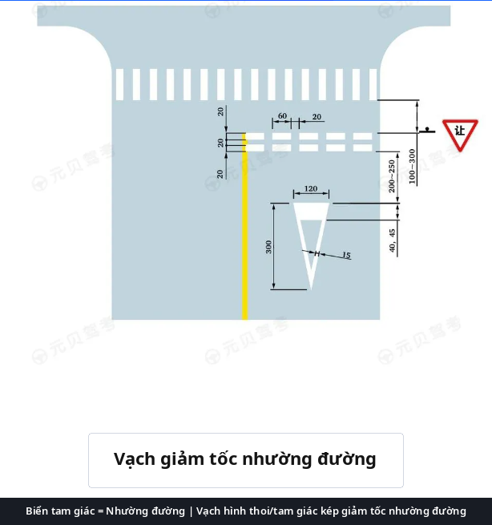 |
| `type` | Loại vạch dừng | `1` | **Vạch dừng** (停止线) | 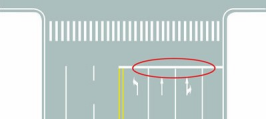 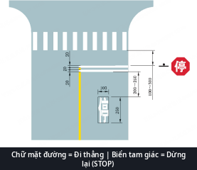 |
| `type` | Loại vạch dừng | `2` | 🟩 **Biển/ký hiệu cảnh báo giảm tốc nhường đường (`slow_warning`)** Thường đặt trước nút giao gần chỗ kết thúc làn xe, nhắc nhở cần giảm tốc nhường đường. **Vẽ một đường tại cạnh đáy của tam giác.** | 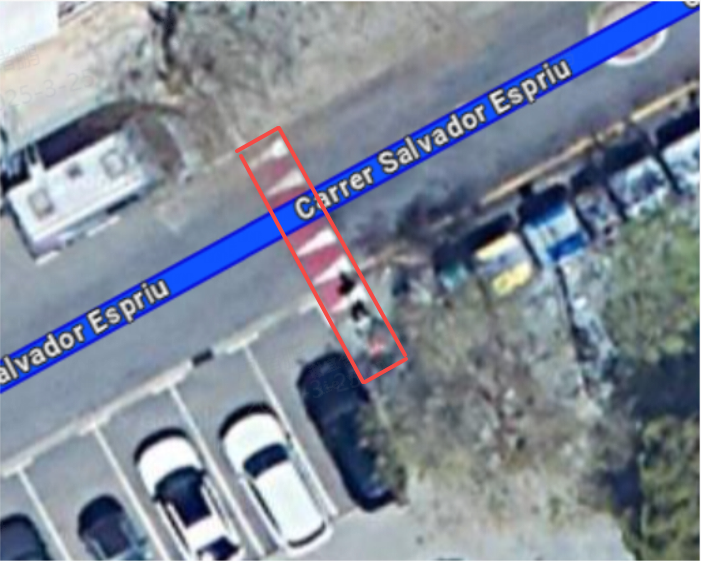 |
| `type` | Loại vạch dừng | `99` | **Khác** (其它 — chọn khi không thể xếp vào các loại trên) | — |
| `points` | Tập điểm của vạch dừng `[(x, y, z)]` | — | — | — |

---

### 1.5 `Roadmarker` —— Nội dung gán nhãn ký hiệu mặt đường

**Định nghĩa:** Các phần tử ký hiệu trên mặt đường hỗ trợ việc lưu thông trong quá trình lái xe, bao gồm mũi tên chỉ hướng trên mặt đường, vạch qua đường (ngựa vằn), khu vực cấm dừng đỗ, mặt nút giao, v.v.

Chi tiết nội dung gán nhãn ký hiệu mặt đường xem tại **Bảng 5**.

- Tổng thể chia thành 2 nhóm: **Mũi tên** và **Các ký hiệu khác**. Có 2 cách gán nhãn chính (tương ứng ký hiệu màu trong Bảng 5):
  - `🟩` **Gán nhãn khung chữ nhật bao ngoài:** Áp dụng cho ký hiệu độc lập có ranh giới đường viền rõ ràng, ký hiệu mũi tên và các đối tượng dạng tuyến (`type = 0..16, 25, 26`).
  - `🟦` **Gán nhãn đa giác (`polygon`):** Áp dụng cho các vùng dạng mặt có hình thái bất quy tắc và phân khu chức năng mặt đường (`type = 17..24, 27`).

#### Bảng 5: Nội dung và mô tả gán nhãn `Roadmarker`

| Nội dung gán nhãn | Mô tả | Miền giá trị | Mô tả loại | Hình minh họa |
| :--- | :--- | :--- | :--- | :--- |
| `road_marker_id` | ID ký hiệu mặt đường | `[0, +∞)` | ID tăng dần bắt đầu từ `0` | — |
| `type` | Loại ký hiệu mặt đường | `0` | 🟩 Mũi tên đi thẳng | 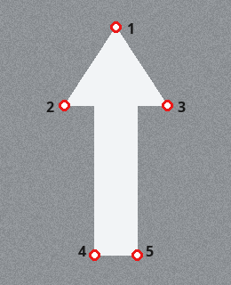 *(Hình minh họa bổ sung cho ô trống trong tài liệu gốc)* |
| `type` | Loại ký hiệu mặt đường | `1` | 🟩 Rẽ cong trái hoặc nhập làn về bên trái | 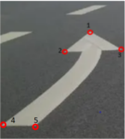 |
| `type` | Loại ký hiệu mặt đường | `2` | 🟩 Rẽ cong phải hoặc nhập làn về bên phải | 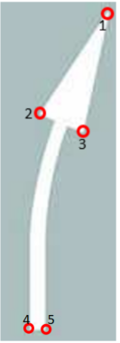 |
| `type` | Loại ký hiệu mặt đường | `3` | 🟩 Mũi tên rẽ trái | 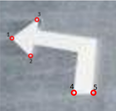 |
| `type` | Loại ký hiệu mặt đường | `4` | 🟩 Mũi tên rẽ phải | 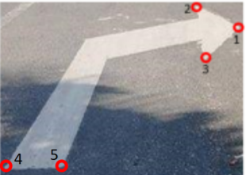 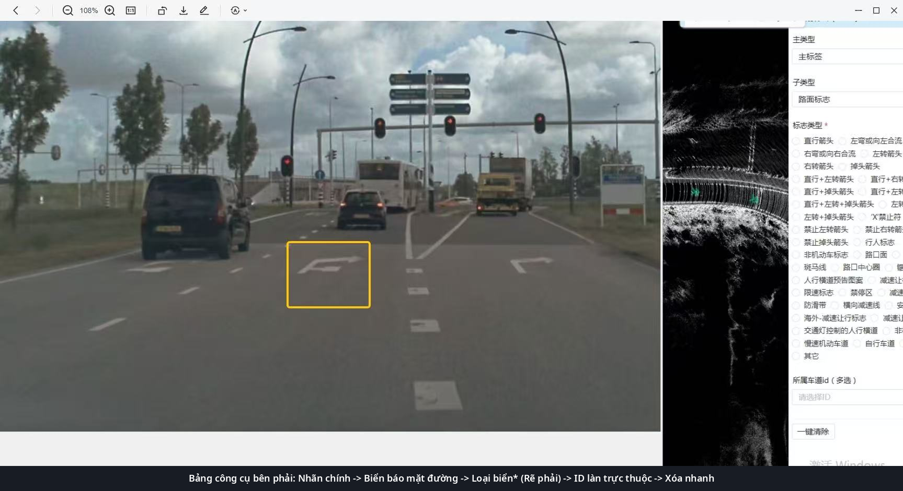 |
| `type` | Loại ký hiệu mặt đường | `5` | 🟩 Mũi tên quay đầu | 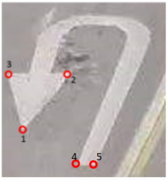 |
| `type` | Loại ký hiệu mặt đường | `6` | 🟩 Mũi tên đi thẳng + rẽ trái | 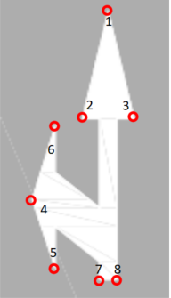 |
| `type` | Loại ký hiệu mặt đường | `7` | 🟩 Mũi tên đi thẳng + rẽ phải | 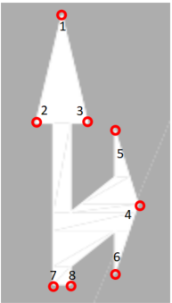 |
| `type` | Loại ký hiệu mặt đường | `8` | 🟩 Mũi tên đi thẳng + quay đầu | 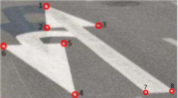 |
| `type` | Loại ký hiệu mặt đường | `9` | 🟩 Mũi tên đi thẳng + rẽ trái + rẽ phải | 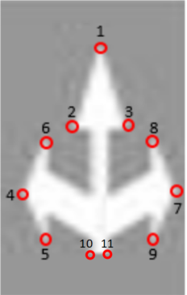 |
| `type` | Loại ký hiệu mặt đường | `10` | 🟩 Mũi tên đi thẳng + rẽ trái + quay đầu | 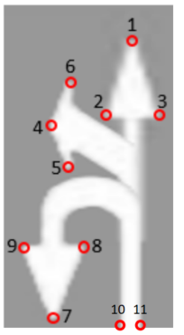 |
| `type` | Loại ký hiệu mặt đường | `11` | 🟩 Mũi tên rẽ trái + rẽ phải | 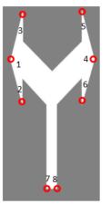 |
| `type` | Loại ký hiệu mặt đường | `12` | 🟩 Mũi tên rẽ trái + quay đầu | 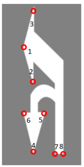 |
| `type` | Loại ký hiệu mặt đường | `13` | 🟩 **Ký hiệu cấm `'X'`** *Lưu ý: Thường xuất hiện cùng mũi tên màu vàng, mang ý nghĩa cấm rẽ trái, cấm rẽ phải, cấm quay đầu.* | 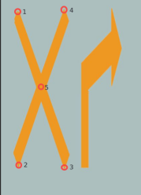 |
| `type` | Loại ký hiệu mặt đường | `14` | 🟩 Mũi tên cấm rẽ trái | 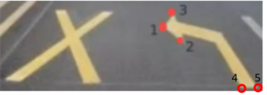 |
| `type` | Loại ký hiệu mặt đường | `15` | 🟩 Mũi tên cấm rẽ phải | 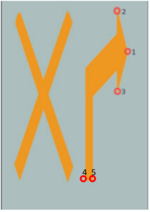 |
| `type` | Loại ký hiệu mặt đường | `16` | 🟩 Mũi tên cấm quay đầu | 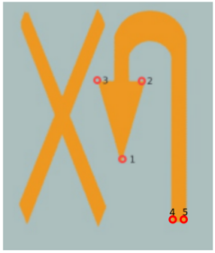 |
| `type` | Loại ký hiệu mặt đường | `17` | 🟦 Mặt nút giao (路口面) | 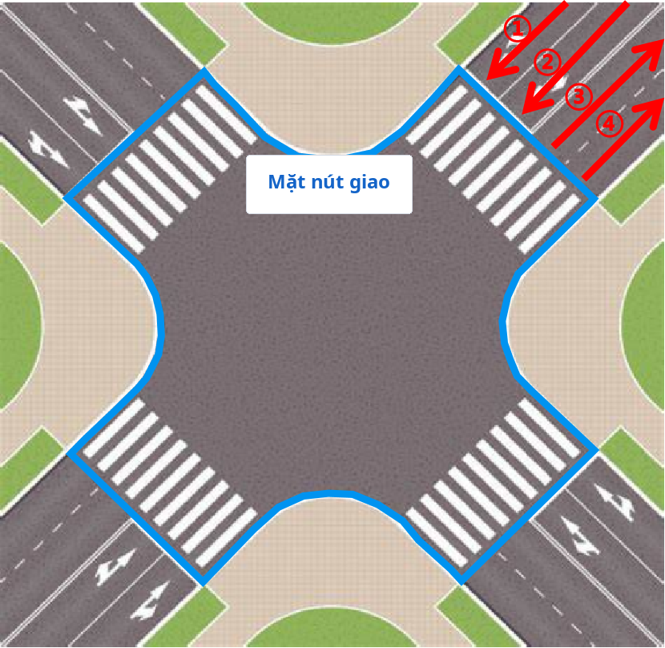 |
| `type` | Loại ký hiệu mặt đường | `18` | 🟦 Vùng đảo dẫn hướng (导流面) | 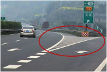 |
| `type` | Loại ký hiệu mặt đường | `19` | 🟦 Vạch qua đường / ngựa vằn (斑马线) | 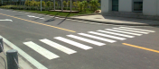 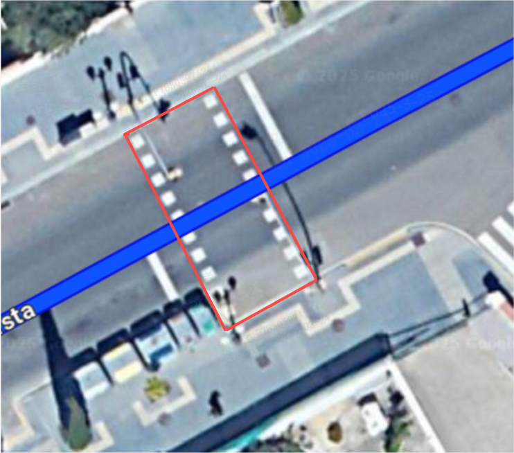   |
| `type` | Loại ký hiệu mặt đường | `20` | 🟦 Khu vực cấm dừng đỗ, thường là vạch mắt võng (禁停区) |  |
| `type` | Loại ký hiệu mặt đường | `21` | 🟦 Khu chờ xe phi cơ giới (非机动车等待区) |  |
| `type` | Loại ký hiệu mặt đường | `22` | 🟦 **Mặt nút giao chữ T** (丁字路口面) Link không cắt nhau, tức chỉ có thể nhập từ đường phụ thuận theo dòng xe đường chính vào đường chính, luồng xe đường phụ không thể cắt ngang luồng xe đường chính. |  *(Hình minh họa thay thế vùng `空白画板` trong tài liệu gốc)* |
| `type` | Loại ký hiệu mặt đường | `23` | 🟦 Mặt nút giao vòng xuyến (环岛路口面) |  |
| `type` | Loại ký hiệu mặt đường | `24` | 🟦 Khu vực xe phi cơ giới màu đỏ (红色非机动区域) |  |
| `type` | Loại ký hiệu mặt đường | `25` | 🟩 Mũi tên vòng xuyến chếch trái (左前环岛箭头) |  |
| `type` | Loại ký hiệu mặt đường | `26` | 🟩 Mũi tên vòng xuyến chếch phải (右前环岛箭头) |  |
| `type` | Loại ký hiệu mặt đường | `27` | 🟦 **Đi thẳng nhường rẽ phải** (直行让右转) Áp dụng khi phía bên phải tại nút giao có ký hiệu mặt đường này. |  |
| `type` | Loại ký hiệu mặt đường | `99` | **Khác** — loại chưa định nghĩa / ký hiệu mặt đường không thể nhận diện | — |
| `polygon` | Tập điểm của đa giác `[(x, y, z)]` | — | — | — |

---

### 1.6 `Slot / Stop_Block` —— Nội dung gán nhãn chỗ đỗ xe và thanh chặn bánh

Cột thứ 1 trong **Bảng 6** liệt kê các nội dung liên quan đến chỗ đỗ xe cần gán nhãn.

#### Bảng 6: Nội dung và mô tả gán nhãn `Slot / StopBlock`

| Nội dung gán nhãn | Mô tả | Miền giá trị | Mô tả loại | Hình minh họa & sơ đồ vị trí điểm khóa |
| :--- | :--- | :--- | :--- | :--- |
| `slot_id` | ID của chỗ đỗ xe | `[0, +∞)` | ID tăng dần bắt đầu từ `0` | — |
| `type` | Loại chỗ đỗ xe chủ yếu gồm: vuông góc, song song, chéo, cơ khí, nhầm lẫn cạnh lối vào, `ignore` | `0` | Chỗ đỗ vuông góc (垂直车位) |  |
| `type` | Loại chỗ đỗ xe | `1` | Chỗ đỗ song song (水平车位) |  |
| `type` | Loại chỗ đỗ xe | `2` | Chỗ đỗ chéo (斜车位) |  |
| `type` | Loại chỗ đỗ xe | `3` | Chỗ đỗ cơ khí (机械车位) |  |
| `type` | Loại chỗ đỗ xe | `99` | **Chỗ đỗ `ignore`** (hình dạng giống chỗ đỗ xe nhưng không thể đỗ ô tô vào được) |  |
| `points` | Tập điểm của chỗ đỗ xe, mảng `[(x, y, z)]` | `[0, +∞)` | Hệ tọa độ ảnh đối với PV; hệ tọa độ thân xe đối với BEV | — |
| `entrance_confusion` | Thuộc tính nhầm lẫn cạnh lối vào | `0` | **Cạnh lối vào rõ ràng:** Có thể xác định rõ ràng cạnh nào là cạnh lối vào |  |
| `entrance_confusion` | Thuộc tính nhầm lẫn cạnh lối vào | `1` | **Chỗ đỗ nhầm lẫn cạnh lối vào:** Chỗ đỗ không thể xác định cạnh đỗ vào; nếu tồn tại nhiều cạnh lối vào thì thống nhất gán là chỗ đỗ nhầm lẫn cạnh lối vào *(xem thêm [giải thích chi tiết](huong-dan-thuat-ngu/entrance-confusion.md))* |  |
| `occupy` | Thuộc tính chiếm chỗ | `0` | **Chưa bị chiếm (trống):** Thuộc tính mặc định, chỗ đỗ có thể đỗ vào và không bị bất kỳ vật cản nào chiếm. Nếu chỉ có xe Ego (tự xe) đỗ bên trong thì vẫn gán nhãn là chưa bị chiếm. |  |
| `occupy` | Thuộc tính chiếm chỗ | `1` | **Xe chiếm chỗ:** Xe cơ giới, trong đó bao gồm cả xe ba bánh đều phải gán nhãn là xe chiếm chỗ. |  |
| `occupy` | Thuộc tính chiếm chỗ | `2` | **Chiếm chỗ động:** Đối với xe phi cơ giới, người đi bộ, xe đẩy trẻ em, xe đẩy siêu thị và các vật cản động có thể di chuyển được thì phải gán nhãn là chiếm chỗ động. |   |
| `occupy` | Thuộc tính chiếm chỗ | `3` | **Chiếm chỗ tĩnh:** Biển (dải) cấm đỗ / khóa chỗ đỗ đang mở / cọc tiêu / rào chắn nước... dùng để báo hiệu cấm đỗ thì phải gán nhãn là chiếm chỗ tĩnh. |  |
| `occupy` | Thuộc tính chiếm chỗ | `4` | **Ký hiệu cấm đỗ trên mặt sàn:** Chỗ đỗ có ký hiệu cấm đỗ trên mặt đường. |  |
| `stop_block` | Tọa độ điểm thanh chặn bánh `[(x, y, z)]` *(chỉ gán nhãn thanh chặn bánh bên trong chỗ đỗ và phải gắn kết với chỗ đỗ đó)* | `[0, +∞)` | 1. Khi là thanh chặn liền một khối: biểu diễn bằng 2 điểm `[p0, p1]`. 2. Khi gồm 2 cục chặn bánh ghép lại: biểu diễn bằng 4 điểm `[p0, p1, p2, p3]`, trong đó `p0, p1` và `p2, p3` mỗi cặp tạo thành một cục chặn bánh. 3. Khi chỉ có 1 cục chặn bánh ở cuối chỗ đỗ: chỉ gán `[p0, p1]`. 4. Khi có 2 cục chặn bánh ở cuối chỗ đỗ nhưng bị lệch góc, miễn vẫn có tác dụng chặn bánh thì gán nhãn bình thường. 5. Trường hợp thanh dài chạy xuyên qua nhiều chỗ đỗ: gán tại vị trí giao cắt với vạch biên chỗ đỗ. 6. Trường hợp có 2 hàng thanh chặn bánh: gán 2 bộ. |  |

---

## 2. Yêu cầu gán nhãn

### 2.1 Yêu cầu gán nhãn BEV

1. Khi loại của `lane`, `border`, `roadedge` thay đổi, chỉ cần ngắt riêng phần tử bị thay đổi loại đó.
2. Mục tiêu gán nhãn vạch làn đường là gán toàn bộ các vạch làn nằm trong vùng hợp lệ *(vùng hợp lệ: khu vực nằm bên trong ranh giới phân cách vật lý hoặc biển báo vật cản ở hai bên)*.
3. Toàn bộ vạch làn: bao gồm cả phần lộ ra thực tế và phần vốn tồn tại nhưng bị che khuất một phần.
4. Các điểm gán nhãn cần bám dọc theo đường tâm của bản thân vạch kẻ làn đường.

---

#### 2.1.1 Đường tâm làn (`Lane`)

1. Mục tiêu gán nhãn đường tâm làn là gán toàn bộ các đường tâm làn nằm trong vùng hợp lệ.
2. **Vùng hợp lệ:** Khu vực nằm bên trong phân cách vật lý ở hai bên *(như hộ lan + bụi cây trên cao tốc)* hoặc biển báo vật cản; nếu gặp cảnh thi công có dùng cọc tiêu để ngăn làn thì vẫn phải gán đường tâm làn bình thường.
3. Bao gồm cả phần lộ ra thực tế và phần vốn tồn tại nhưng bị che khuất một phần.
4. Độ rộng làn đường để gán đường tâm làn phải **`>= 2.5 m`**.
5. Điểm đầu và hướng vẽ của đường tâm làn một chiều phải thống nhất với hướng xe chạy của làn đó.
6. Ngắt đoạn đường tâm làn khi thay đổi thuộc tính hoặc tại kịch bản cần chuyển làn topo; đảm bảo tọa độ điểm hình học trước và sau khi ngắt trùng khớp, đồng thời góc chuyển hướng của đường tâm làn phải **`< 45°`**.
7. Mỗi làn đường *(trừ làn xe phi cơ giới, khu vực nút giao và vị trí biến đổi số lượng làn)* chỉ có duy nhất **1 đường tâm làn**, và độ dài phải khớp với độ dài thực tế của làn.

   

8. **Kịch bản tâm làn `1 tách N` / `N gộp 1`** cần tạo topo kết nối; trong đó **làn khẩn cấp không kết nối với bất kỳ loại làn nào khác**, **làn xe cơ giới không kết nối với làn xe phi cơ giới**; khi làn loại khác kết nối với làn thường thì đoạn nối ưu tiên gán thuộc tính **làn loại khác**; nếu trước và sau đều là làn loại khác thì đoạn nối gán theo thuộc tính của làn kế tiếp (phía sau) và nối thành một đối tượng (instance) liên tục.

   
   

9. Khi một làn trên đường thay đổi độ rộng và sau khi mở rộng đạt chiều rộng **`>= 6 m`**, đường tâm làn được chia đều theo chuẩn chiều rộng đơn làn `3 m` kể từ vị trí độ rộng không còn thay đổi; đường tâm làn của làn đơn phía trước hoặc phía sau phải kết nối topo tới các đường tâm làn đã chia đều *(kịch bản `1 tách N` / `N gộp 1`)*. Nếu tại vị trí kết thúc biến đổi mà độ rộng làn **`< 6 m`**, thực hiện kết nối **`1-1`**.

   
   

10. Trong kịch bản **`N sang N`**, đường tâm làn không ngắt đoạn; khi làn loại khác kết nối với làn thường thì tại vị trí đổi thuộc tính cần ngắt đoạn; trong khu vực không vạch (lineless area), ưu tiên gán thuộc tính của làn loại khác.

    
    

11. **Kịch bản tâm làn `N sang M` (`N ≠ M`, đồng thời cả `N` và `M` đều `> 1`):** *(xem thêm [giải thích quan hệ topo & 11a vs 11b](huong-dan-thuat-ngu/quan-he-topo.md))*
    - **a. Phía gán nhãn:** Cần nối toàn bộ các cặp đường tâm làn khả dĩ với nhau. Các đường nối bên trong vùng không vạch gán thuộc tính vùng không vạch (`type = 7`), giữ ở trạng thái ngắt đoạn.

      

    > **[🔴 XỬ LÝ PHÍA TÍCH HỢP]** **b. Phía tích hợp:** Xóa các quan hệ topo không tối ưu, xóa thuộc tính vùng không vạch và thực hiện nối thành một instance dài liên tục theo minh họa dưới đây.

      

12. Trong kịch bản **1 vạch qua đường (ngựa vằn) không có topo**, đường tâm làn giữ nguyên trạng thái nối liền; đường tâm làn tại làn rẽ phải chuyên biệt *(nhánh rẽ phải riêng)* đi qua vạch ngựa vằn cũng giữ nối liền không ngắt. Trong kịch bản **2 vạch qua đường không có topo**, cả hai vạch qua đường cùng phần diện tích nằm giữa phải được gán thành **mặt nút giao**, và đường tâm làn phải **ngắt đoạn tại mặt nút giao**.

    

13. Trên đoạn đường mà trước/sau khi vào/ra nút giao không có vạch kẻ làn, vẫn phải kéo đường tâm làn tới sát vị trí nút giao để đảm bảo kết nối nút giao hoàn chỉnh.

    

14. Bên trong vạch dẫn hướng (`border type = 2`) **không** gán đường tâm làn (áp dụng cho cả trường hợp vạch đơn và vạch đôi).
15. Với vạch làn bên trong mặt nút giao ở thị trường nước ngoài, chỉ cần gán **vạch dẫn hướng (`guide line`)**, không cần gán làn (`lane`) cũng như quan hệ ràng buộc của nó. Thực hiện gán nhãn theo nguyên tắc "nhìn thấy sao vẽ vậy" đúng theo hình dạng tuyến thực tế.

    

16. Đường nông thôn không có vạch làn: xác định chiều rộng đường dựa theo mép đường (`roadedge`) và tạo đường tâm làn theo độ rộng đó.

---

#### 2.1.2 Vạch làn đường (`Border`)

1. Biên làn được mô tả như thuộc tính của các điểm trên đường tâm làn; khi làn có biên nhìn thấy được (có tồn tại) thì phải gán nhãn.
2. Trong kịch bản nối giữa **vạch đơn và vạch đôi**: khi vạch nối phía trước/sau của vạch đơn là vạch đôi, cần nối với **1 vạch làn có góc lệch (độ bẻ góc) nhỏ nhất** và ngắt đoạn khi kiểu nét vạch thay đổi.

   
   

3. Trong kịch bản vạch bốn có điểm quay đầu hình chữ U, việc gán nhãn không cần thể hiện đường cong chữ U mà gán nhãn theo quy tắc minh họa dưới đây:

   

4. Khi vạch làn bị nắp cống, đoạn vá đường, xe cộ... che khuất gây đứt đoạn hoặc mờ không rõ: nếu loại vạch trước và sau giống nhau thì giữ nối thông theo hướng tuyến của làn; nếu loại vạch trước và sau khác nhau thì **ưu tiên gán là vạch nét đứt**.
5. Nếu vật cản cố định không thể di dời *(khối bê tông, hàng rào cứng trên đoạn đường)* chồng hoàn toàn lên vạch làn, tiến hành gán nhãn vạch làn tối đa theo khả năng quan sát thực tế.
6. Khi vạch làn bị cọc tiêu, rào chắn nước, xe cộ, đèn giao thông di động, hàng rào *(trong nút giao)* đè lên nhưng vẫn nhận diện được ngữ nghĩa và vị trí vạch làn: gán nhãn vạch làn đúng vị trí thực tế và giữ nối liền.

   

7. Khi vạch làn bị cọc tiêu, rào chắn nước, xe cộ, đèn giao thông di động, hàng rào *(trong nút giao)* che phủ từng phần — một phần nhận diện được loại và vị trí, phần còn lại không nhận diện được: nếu vạch trước và sau cùng loại thì nối thông theo trước/sau; nếu vạch trước và sau khác loại thì **phần bị rào chắn nước che đè ưu tiên gán thành nét liền**.

   

8. Trên đoạn đường bình thường, khi vạch làn bị khu vực cấm dừng đè lên thì cần gán bổ sung vạch làn dựa theo đoạn trước/sau: nếu trước và sau cùng kiểu vạch thì phần bị đè giữ nguyên kiểu vạch giống trước/sau; nếu trước và sau khác kiểu vạch thì **phần bị đè gán thành nét liền**.

   

9. Tại chỗ mở dải phân cách (`豁口`) và đoạn tách/nhập làn (`分汇流`), nếu vạch làn bị khu vực cấm dừng đè lên thì **không cần gán nhãn** vạch làn; phần topo đường tâm làn được gán theo tình trạng vạch làn thực tế tồn tại: nếu làn nhập gồm nhiều làn có vạch phân tách thực tế ở giữa thì gán nhiều điểm nhập riêng biệt; nếu làn nhập gồm nhiều làn không có vạch phân tách thực tế ở giữa thì gộp thành 1 đường rồi mới nhập vào làn chính.

   

---

#### 2.1.3 Mép đường (`Roadedge`)

1. Khi hai bên đường gặp thời tiết cực đoan có tuyết phủ, gán nhãn mép đường theo **viền ngoài của đống tuyết**.

   

2. Khi mép đường gặp bồn hoa hoặc chỗ mở dải phân cách, cần bám theo đường cong chữ U để gán hoàn chỉnh mép đường.

   
   

3. Khi trên đường xuất hiện liên tiếp các vật cản cố định không thể di dời như tường rào thi công, trụ chắn đường, khối bê tông: phải gán nhãn mép đường dọc theo xu hướng của hàng vật cản *(đường màu xanh lá trong hình)*; vạch làn gán trung thực theo tình trạng nhìn thấy được. Nếu mép đường lấn vào làm làn không đủ `2.5 m` bề rộng, đường tâm làn đó phải gán là **đường cụt (`断头路`)** *[điều kiện phán đoán cốt lõi: phía trước vị trí mép đường lấn vào có vạch dẫn hướng chuyển làn hay không — nếu không có thì gán đường cụt]*.

   

4. Khi trên đường có vật cản di dời được và ranh giới đường đã rõ ràng, **không** vẽ mép đường chạy theo vị trí vật cản mà gán theo mép đường thực tế *(đường màu xanh lá trong hình)*.

   

5. Đường dân sinh trong vùng nông thôn: khi hai khu vực có chất liệu mặt nền giống nhau hoặc tương đối giống nhau thì không nên tự ý gán mép đường. Nguyên tắc ở đây là phản ánh chân thực hiện trạng: cần bám sát các công trình nhô ra như tường nhà / hố cây / bồn hoa / cột điện... để gán nhãn.

   

6. Khi đường đi vào khu dân cư / hầm đỗ xe: cần kéo dài mép đường vào bên trong lối vào, khuyến nghị độ dài phần kéo dài **không nhỏ hơn chiều rộng lối vào**.
7. Nếu có hộ lan/lan can cao hơn mặt đường, mép đường được lấy tại **cạnh dưới của hộ lan**; nếu không có hộ lan nhô cao thì lấy theo ranh giới đường có ngữ nghĩa rõ ràng và có thể nối thành đường cong liên tục hoàn chỉnh.
8. **Suy đoán bù mép đường (路沿脑补):** Khi điểm đám mây (point cloud) của mép đường trong ảnh BEV bị thưa hoặc che khuất một phần, nhưng qua ảnh PV có thể xác định được hình dạng và vị trí tương đối thì tiến hành suy đoán bù; nếu đám mây điểm BEV mất hoàn toàn cả đoạn dài hoặc qua ảnh PV thấy hình thái phức tạp *(như có khúc gấp hoặc khoảng hở)* khiến sai số suy đoán lớn thì **không** suy đoán bù. Chỉ cần bản thân mép đường nhìn thấy được hoặc đủ điều kiện suy đoán bù là phải gán nhãn, bất kể gần đó có vạch làn hay không hoặc vạch làn trên đường có rõ ràng/đầy đủ hay không.
9. Mép đường tại biên của mọi loại ngã rẽ *(cung tròn, đường gấp khúc, đường thẳng...)* đều phải gán nhãn; bất kể hình thái nút giao *(ngã tư, ngã ba chữ T, ngã rẽ tách, ngã nhập, chỗ mở quay đầu)*, cấp đường *(đường trục, đường nhánh, đường nội khu, cổng khu dân cư/khu công nghiệp/bãi xe/cây xăng...)*, hay việc có vạch dừng/vạch ngựa vằn hay không — miễn chiều rộng, vật liệu và độ bằng phẳng đủ cho xe ô tô đi qua đều xem là ngã rẽ. Chiều điểm của mép đường biên ngã rẽ phải trùng với mép đường lân cận gần nhất; nếu nằm giữa hai mép đường lân cận ngược chiều nhau thì tách đôi ở chính giữa hoặc tại góc bẻ lớn *(khoảng hở ngắt không vượt quá `40 cm`)*.
10. Thứ tự điểm của mép đường phải trùng với **hướng xe chạy**, như mũi tên đỏ minh họa trong các hình sau:

    
    

---

#### 2.1.4 Vạch dừng (`Stopline`)

1. Gán nhãn vạch dừng theo tình trạng thực tế, chỉ cần dùng **1 đường** cho mỗi vạch dừng.
2. **Cách gán vạch dừng dạng bậc thang:** Các làn nằm trên các mặt phẳng ngang (vị trí dọc) khác nhau thì gán mỗi nhóm một vạch dừng riêng.

   

3. **Cách gán vạch dừng dạng nghiêng & dạng ngang:** Nhiều làn thẳng hàng gán chung bằng 1 vạch dừng duy nhất; vạch dừng là một đoạn thẳng gồm **2 nút đầu-cuối**.

   

4. **Vạch dừng của làn thủy triều:** Gần nút giao tại làn thủy triều thường có vạch nét đứt hoặc nét liền + nét đứt vuông góc với chiều xe chạy — đây là vạch dừng riêng của làn thủy triều và **phải gán thành `stopline`**. Nếu nằm thẳng hàng với vạch dừng thường thì vẽ chung 1 đường; nếu phân bố lệch bậc thang so với vạch dừng thường thì vẽ tách riêng.

   
   

5. **Kịch bản vạch dừng kép:** Đối với kịch bản có vạch dừng kép *(vạch dừng xe phi cơ giới / xe tải lớn đặt phía trước vạch dừng xe cơ giới)*: **không** gán nhãn vạch dừng xe phi cơ giới hay xe tải lớn, chỉ gán nhãn **vạch dừng xe cơ giới**. Các vạch làn nằm giữa hai vạch dừng này cũng **không** cần gán nhãn; vùng giữa hai vạch dừng gán thành **khu chờ xe phi cơ giới**.

   

---

#### 2.1.5 Ký hiệu mặt đường (`Roadmarker`)

1. Sử dụng **khung chữ nhật bao ngoài** và **đa giác (`polygon`)** để gán nhãn. Phân loại chi tiết xem tại **Mục 1.5 — Bảng 5**.
   - **Mũi tên chỉ dẫn:** Khi gán `polygon` cho mũi tên chỉ dẫn, **điểm bắt đầu** chọn tại góc trên bên trái tính theo hướng mũi tên dọc theo chiều làn đường.
   - **Vạch qua đường (ngựa vằn):** Khi gán `polygon` cho vạch qua đường, **2 điểm đầu tiên** phải đảm bảo nằm **song song với chiều lưu thông của làn đường**.

---

#### 2.1.6 Chỗ đỗ xe và thanh chặn bánh (`Slot / StopBlock`)

##### 2.1.6.1 Quy tắc gán nhãn chỗ đỗ xe

1. **Thứ tự điểm góc:**
   **Thứ tự điểm góc cực kỳ quan trọng!! Tuyệt đối không được gán sai thứ tự điểm góc trong mọi trường hợp.** Khi gán, phải đặt điểm tại **các góc trong của vạch kẻ chỗ đỗ**.
   - **a.** Mỗi chỗ đỗ xe bắt buộc phải có đúng **4 điểm góc** (không được ít hơn hoặc nhiều hơn 4 điểm).
   - **b.** Thứ tự các điểm góc `0, 1, 2, 3` sắp xếp **theo chiều kim đồng hồ**.
   - **c.** Cạnh nối từ điểm `0` đến điểm `1` (`0-1`) **luôn luôn phải là cạnh lối vào** của chỗ đỗ.
   - **d.** *Mẹo nhỏ:* Luôn đi vòng theo chiều kim đồng hồ khi bấm điểm, đồng thời đảm bảo đoạn nối đầu tiên chính là cạnh lối vào thì sẽ không bao giờ gán sai thứ tự.

   
   

2. **Thuộc tính nhầm lẫn cạnh lối vào (`entrance_confusion`):**
   - **Định nghĩa:** Do trên bản đồ nền lớn không cố định vị trí xe Ego nên có thể tồn tại nhiều cạnh có thể đi vào *(tại ngã tư hoặc tiếp giáp nhiều vùng xe đi được: xung quanh các cạnh chỗ đỗ không có vật cản cố định không di dời được như cột, thanh chặn bánh, tường...)*; trường hợp này thống nhất gán thuộc tính **`entrance_confusion = 1`**. *(Quy ước màu trên sơ đồ vector tại mục này trong PDF gốc: màu xanh lá là viền chỗ đỗ, màu xanh dương là thanh chặn bánh, màu đen là vạch làn đường chính, màu đỏ là cạnh lối vào — đồng nhất với sơ đồ minh họa ở Bảng 6.)*
3. **Trường hợp bị cắt góc (truncation):** Khi điểm góc thực tế nằm ngoài khung hình khiến chỗ đỗ bị cắt bớt, gán điểm ngay trên mép khung hình *(ảnh trái là hiện trạng gốc, ảnh phải là kết quả sau gán nhãn)*.

   
   

4. **Điểm lối vào chỗ đỗ cơ khí:** Các điểm góc lối vào của chỗ đỗ cơ khí được thống nhất gán tại **điểm bắt đầu của hai thanh dẫn hướng/lan can ở hai bên**, như minh họa sau:

   
   

##### 2.1.6.2 Quy tắc gán nhãn thanh chặn bánh (`stop_block`)

1. Thanh chặn bánh là thuộc tính phụ thuộc của chỗ đỗ xe: chỉ gán thanh chặn bánh nằm **bên trong chỗ đỗ** và bắt buộc phải gắn kết (bind) với chỗ đỗ đó.
2. Khi là thanh chặn liền một khối: biểu diễn bằng **2 điểm `[p0, p1]`**.
3. Khi gồm 2 cục chặn bánh ghép lại: biểu diễn bằng **4 điểm `[p0, p1, p2, p3]`**, trong đó `p0, p1` và `p2, p3` mỗi cặp tạo thành 1 cục chặn bánh.
4. Khi chỉ có 1 cục chặn bánh ở đuôi chỗ đỗ: chỉ gán **`[p0, p1]`**.
5. Khi có 2 cục chặn bánh ở đuôi chỗ đỗ nhưng đặt lệch góc/tư thế, miễn vẫn có tác dụng chặn bánh thì gán nhãn bình thường.
6. Trường hợp thanh dài chạy xuyên qua nhiều chỗ đỗ: gán điểm tại vị trí giao cắt với vạch biên chỗ đỗ.
7. Trường hợp có 2 hàng thanh chặn bánh: gán thành 2 bộ.

   

   Thông thường gán nhãn trực tiếp theo mức độ nhìn thấy trên bản đồ nền lớn, thấy bao nhiêu gán hết bấy nhiêu. Khi bản đồ nền bị mờ hoặc bị che khuất, cần kết hợp kiểm tra các khung hình ảnh trước và sau để phán đoán; nếu quan sát được thì bắt buộc phải gán:
   - **a.** Thanh chặn liền bị che khuất: chỉ cần trong bất kỳ ảnh nào nhìn thấy được độ dài **vượt quá `1/6`** *(đủ nhận diện là thanh chặn bánh)* thì phải gán.
   - **b.** Cục chặn bánh bị che khuất: chỉ cần trong bất kỳ ảnh nào nhìn thấy được độ dài **vượt quá `1/3`** *(đủ nhận diện là cục chặn bánh)* thì phải gán.
   - **c.** Điểm bị che khuất cần tham chiếu theo các thanh chặn cùng quy cách ở lân cận để ước lượng vị trí chính xác.
   - **d.** *Lưu ý:* Trong ảnh PV, chỉ cần nhìn thấy một trong các thanh chặn bánh phía trước thì đều phải gán nhãn.
   - **e.** Thanh chặn bị nhòe không rõ nét cần tham chiếu dữ liệu của các thanh chặn rõ nét cùng quy cách ở gần đó để đảm bảo đồng nhất về độ dài và góc nghiêng.

---

### 2.2 Gán nhãn kịch bản làn quay đầu chuyên biệt

1. Làn quay đầu kết nối topo với các đường tâm làn khác; nếu phía đối diện có nhiều làn thì chỉ vẽ **1 làn quay đầu** kết nối vào.
2. Mép đường hai bên chỗ mở quay đầu gán nhãn bình thường; nếu dải phân cách ở giữa là bồn hoa có bề ngang rộng thì mép đường cần bám sát biên bồn hoa; nếu là hộ lan có bề ngang hẹp thì không cần thể hiện độ dày ngang của hộ lan.

    *Ghi chú minh họa gốc: Điểm đỏ là vị trí ngắt tâm làn; xanh lá là đường tâm làn; tím là mép đường; khung vàng là vị trí xe Ego.*

---

### 2.3 Quy tắc gán nhãn vịnh dừng xe (港湾式停靠区)

1. **Vịnh dừng xe buýt:** Khi giữa vịnh dừng và làn xe cơ giới có vạch kẻ làn, thực hiện nối đường tâm làn đúng như sơ đồ minh họa:

   

2. **Vịnh dừng khẩn cấp bên đường:** Khi có biển báo hoặc chữ sơn mặt đường ghi *"Vịnh dừng khẩn cấp"* (紧急停靠区), **không** vẽ đường tâm làn bên trong vịnh dừng khẩn cấp.

   

3. **Vịnh dừng nằm phía ngoài làn xe phi cơ giới:**
   - Khi vạch phân tách giữa làn cơ giới và làn phi cơ giới là **nét đứt**, vẽ đường tâm làn bên trong vịnh dừng bình thường và đảm bảo kết nối liên thông; làn xe phi cơ giới ngắt đoạn trước và sau điểm chuyển làn.
   - Khi vạch phân tách giữa làn cơ giới và làn phi cơ giới là **nét liền**, **không** vẽ đường tâm làn vào vịnh dừng.

   
   

4. Khi tồn tại đồng thời làn xe phi cơ giới và vịnh dừng xe buýt dạng mở thẳng không có topo nhập/tách như minh họa, **không** cần tạo kết nối topo cho tâm làn vịnh dừng.

   

---

### 2.4 Quy tắc gán nhãn làn đường có chỗ đỗ xe

Phân làm 2 trường hợp theo chiều rộng `W` của làn đường chứa chỗ đỗ xe:

1. Khi **`W ≥ 3 m`**: Gán vạch làn theo đúng kiểu vạch thực tế tại ranh giới chỗ đỗ; nếu khoảng cách giữa các chỗ đỗ **`H < 10 m`** thì bỏ qua khoảng hở giữa chúng và chia làn đường thành 2 làn song song.

   

2. Khi **`W < 3 m`**: Không vẽ vạch nét đứt tại biên chỗ đỗ; vạch làn bên ngoài gán theo thực tế và đường tâm làn gán là **1 làn thường duy nhất**.

   

---

### 2.5 Quy tắc gán nhãn kịch bản vòng xuyến

- **Làn trong vòng xuyến:** Gán vạch làn theo đúng vạch thực tế trên mặt đường; gán đường tâm làn theo đúng số làn và độ rộng thực tế của vòng xuyến.
- **Logic kết nối (ngắt/nối):** **Không kết nối trực tiếp vào vòng xuyến** — các đường tâm làn đi **vào** vòng xuyến kết thúc tại **vạch dừng trước mặt nút giao vòng xuyến**; các đường tâm làn đi **ra** khỏi vòng xuyến bắt đầu từ **cạnh mặt nút giao vòng xuyến**.

  
  

- Nếu trong vòng xuyến có vùng đảo dẫn hướng (chữ V / vạch xương cá), phải gán `roadmarker` vùng đảo dẫn hướng (`type = 18`), và **đường tâm làn tuyệt đối không được vẽ đè lên vùng đảo dẫn hướng**.

---

### 2.6 Quy tắc gán nhãn kịch bản trạm thu phí

1. **Gán nhãn đoạn dẫn vào/ra trạm thu phí:**
   - **a.** Cần gán mép đường (`roadedge`) hai bên đoạn đường; mép đường phải bám sát thực tế và giữ tính liên tục với hai đầu đoạn trước/sau.
   - **b.** Cần gán vạch làn (`border`) đúng theo hình thái thực tế.
   - **c.** Cần gán đường tâm làn (`lane`) đúng theo hình thái thực tế; nếu đoạn dẫn vào/ra thuộc khu vực không có vạch kẻ làn, phải suy đoán vạch làn để tạo đường tâm làn và **gán `type = 8` (Làn khu vực không vạch trước trạm thu phí)**; đồng thời tâm làn đoạn vào/ra phải nối thành **instance dài liên tục** với tâm làn bên trong trạm thu phí.
2. **Gán nhãn bên trong trạm thu phí:** Khu vực bên trong thường có vạch kẻ làn, phải gán chính xác theo vị trí và hình dạng phân bố thực tế của vạch làn; nếu có mép đường thì gán theo thực tế, và đường tâm làn gán theo thực tế từng cửa thu phí.
3. **Kịch bản mở rộng số làn tại lối vào trạm thu phí:** Khi số làn tăng lên từ lối vào vào trạm thu phí, nối **1-1 thành instance dài liên tục** giữa làn vào và làn trong trạm theo **"nguyên tắc gần nhất"** *(góc kẹp nối nhỏ nhất)*; các làn tăng thêm còn lại thực hiện **kết nối topo** theo **"nguyên tắc gần nhất"**.
4. **Kịch bản thu hẹp số làn tại lối ra trạm thu phí:** Khi số làn giảm đi từ trạm ra đường chính, nối **1-1 thành instance dài liên tục** giữa làn trong trạm và làn ra theo **"nguyên tắc gần nhất"** *(góc kẹp nối nhỏ nhất)*; các làn còn lại thực hiện **kết nối topo** theo **"nguyên tắc gần nhất"**.
5. **Công trình phụ trợ tại trạm thu phí:** Đảo dẫn hướng và các yếu tố phụ trợ khác phải được gán trung thực theo hiện trạng thực tế; tại các vùng đám mây điểm bị thưa cần dựa vào hình ảnh để gán hoặc suy đoán bù hợp lý cho mép đường.

   

---

### 2.7 Quy tắc gán nhãn làn siêu rộng

**Điều kiện áp dụng:**
- Khoảng bề rộng: **`6 m (bao gồm) ≤ Độ rộng đường ≤ 7.5 m (bao gồm)`**; gồm hai làn đơn cùng chiều hoặc ngược chiều.
- Đoạn rộng `5 m – 6 m`: gán **1 làn**.
- Đoạn trên `6 m`: chia đều theo chuẩn **`3 m`**.

**Yêu cầu gán nhãn:**
- **Đường tâm làn:** Gán **2 đường**, phân bố đều theo bề rộng đường, đảm bảo độ rộng mỗi làn đơn **`> 3 m`**.
- **Vạch làn hai bên:** Gán theo tình trạng tồn tại thực tế; nếu không có thì không tự vẽ thêm.

---

### 2.8 Quy tắc gán nhãn khu vực chờ

Đường tâm làn khu chờ phải **xuyên qua vạch qua đường (ngựa vằn)** và nối tiếp với đường tâm làn ngoài nút giao; đường tâm làn tại **vạch dừng** phải **ngắt đoạn và kết thúc**.

> **[🔴 XỬ LÝ PHÍA TÍCH HỢP]** Phía tích hợp: Đường tâm làn của làn chờ (`type = 6`) **không nối thành instance dài liên tục** với các đường tâm làn khác.

---

### 2.9 Quy tắc gán nhãn đường chính – phụ không hướng, không vạch

*(Trong bản PDF gốc, khung minh họa đầu mục 2.9 để trống là `空白画板`, được bổ sung bằng sơ đồ minh họa chuẩn bên dưới.)*

Tạo một đường kết nối topo hướng vào đường phụ dựa theo chiều xe chạy của xe Ego, với điểm đầu nằm trên làn xe Ego đang chạy.

**Quy tắc:**
1. Điểm đầu của đường nối luôn nằm về **phía gần xe Ego**.
2. Đường tâm làn được vẽ ở **chính giữa hai mép đường của nhánh nối**, giữ đường thẳng phẳng ngang; điểm đầu và điểm cuối phải bắt dính (snap) vào đường tâm làn ở hai bên.
3. Thuộc tính `lane`: gán **Làn thường hai chiều** **[Khâu gán nhãn]**.

> **[🔴 XỬ LÝ PHÍA TÍCH HỢP]** Thuộc tính topo của `lane` này được gán là thuộc tính **`merge`** **[Khâu tích hợp]**.

---

### 2.10 Quy tắc gán nhãn đường cấp thấp

1. **Gán nhãn đường tâm làn:**
   - **a.** Khi chiều rộng đường **`< 6 m`**, gán **1 làn hai chiều**; khi chiều rộng đường **`> 6 m`**, gán **2 làn hai chiều**.
   - **b.** Khi chiều rộng đường thay đổi từ hẹp sang rộng hoặc từ rộng sang hẹp: nếu chiều dài đoạn thay đổi **`< 60 m`** thì giữ nguyên cách gán ban đầu; nếu chiều dài **`> 60 m`** thì phải thực hiện gán nhãn topo **`1 tách 2`** hoặc **`2 gộp 1`**.

     

   - **c.** Tại khúc cua, đoạn gãy khúc, đoạn cua chữ S, đường tâm làn phải được đặt **chính giữa** lòng đường.
   - **d.** Khi đường trải nhựa/bê tông nối với đường đất/chưa lát mặt, **không được** gán đường tâm làn lên phần mặt đường chưa lát.
   - **e.** Đường nhánh của đường cấp thấp phải gán cả tâm làn và topo kết nối, với ngưỡng chiều dài **`10 m`** và ngưỡng chiều rộng **`2.5 m`** *(nếu rộng `< 2.5 m` thì không gán)*:
     - **i.** Nếu đường nhánh là 1 làn hai chiều *(rộng `< 6 m`)*: chỉ cần gán **topo nhập làn**.
     - **ii.** Nếu đường nhánh là 2 làn hai chiều *(rộng `> 6 m`)*: phải gán **cả topo nhập làn và topo tách làn**.

      
     

2. **Gán nhãn mép đường (`Roadedge`):**
   - **a.** Gán chính xác theo vị trí mép đường thực tế hai bên *(đặc biệt tại đoạn cong, khúc gấp, cua chữ S phải bám thật chuẩn)*.
   - **b.** Mép đường xi măng gãy khúc phải gán chính xác theo ranh giới thực tế của mép đường xi măng.
3. **Gán nhãn vạch làn (`Border`):** Khi mặt đường có vạch kẻ làn thực tế, gán chính xác theo vạch làn thực tế đó.

   

---

### 2.11 Quy tắc gán nhãn kịch bản thi công

1. **Gán nhãn vạch mới – vạch cũ:**
   - **a.** Khi vạch mới và vạch cũ phân biệt rõ ràng:
     - Nếu xuất hiện **chồng lấn nhau**, phần vạch cũ bị chồng lấn **không** cần gán lại, lấy loại vạch theo **vạch mới** *(trong ảnh bên dưới, vạch mới là nét đứt)*.
     - Nếu vạch nét liền mà mũi tên đỏ chỉ tới nhạt màu hơn rõ rệt so với các vạch làn khác cùng đoạn, không chồng lấn và xung đột với quỹ đạo chạy xe hiện tại thì xác định là **vạch cũ**, gán thuộc tính **`Vạch bỏ qua / Vạch cũ` (`border type = 5`)**.

     
     

   - **b.** Khi độ rõ nét của các vạch không chênh lệch rõ ràng và mức độ cũ/mới của đám mây điểm tương đương nhau: phải kết hợp quỹ đạo xe chạy và đoạn làn trước/sau để phán đoán. Vạch khớp với đoạn trước/sau là vạch mới; vạch xung đột với quỹ đạo chạy xe là vạch cũ *(như hình dưới, căn cứ quỹ đạo và bề rộng làn thấy vạch 1, 2 bị xung đột nên phải gán thuộc tính `Vạch bỏ qua / Vạch cũ`)*.

     
     

   - **c.** Khu vực thi công thường phân biệt vạch mới/cũ bằng màu sắc khi độ rõ tương đồng: **vạch vàng là vạch mới, vạch trắng là vạch cũ** *(quy tắc hỗ trợ phán đoán, không tuyệt đối 100%)*; cần gán các vạch làn trắng tại vị trí thi công sang thuộc tính **`Vạch bỏ qua / Vạch cũ`**.

     

2. **Chuyển làn của đường tâm làn:**
   - **a.** Khi một phần số làn bị vật cản cố định che chắn do thi công/rào đường khiến không thể đi thẳng bình thường, nhưng **vẫn còn làn khác không bị ảnh hưởng**: đường tâm làn phải thực hiện chuyển làn tại đoạn nét đứt sang làn thường không bị ảnh hưởng. Như hình minh họa dưới đây, `Đường 1` vẫn còn phần làn đi thẳng mũi tên xanh đi qua được nên phải kéo nối đường tâm làn theo xu hướng rào chắn sang làn lưu thông được.

     

   - **b.** Khi **toàn bộ tuyến đường** bị vật cản cố định không thể di dời rào kín/che khuất hoàn toàn: cho phép ngắt cụt đường tâm làn, kéo đến ngang bằng cạnh ngắn của vạch làn/mép đường tại chỗ không đi tiếp được. Như hình dưới đây, toàn bộ làn lưu thông thuộc phạm vi `Đường 2` bị chặn kín nên đường tâm làn chỉ vẽ đến ngang biên ngắn chỗ bị chặn, **không** chuyển sang `Đường 1`.

     

---

## 3. Ví dụ các quy tắc đặc biệt

| Giải thích | Hình minh họa |
| :--- | :--- |
| Chỉ gán nhãn vạch làn đường (nhóm 209) |  |
| Cọc tiêu và rào chắn nước bít kín đường thì gán nhãn là đường cụt |  |
| Đối với làn có chỗ đỗ xe được ngăn cách cứng bởi bồn hoa, nếu chỉ còn duy nhất 1 làn lưu thông được thì **bỏ qua chỗ đỗ xe**, gán nhãn như làn đường bình thường |  |
| Với lối vào khu dân cư hoặc khuôn viên *(nút giao đường cấp thấp)*: nếu xác định chắc chắn được là **mặt nút giao chữ T** thì gán mặt nút giao chữ T; nếu xác định không phải mặt nút giao chữ T thì theo quy chuẩn gán nhãn thủ công trước đây, đường cấp thấp vào khu dân cư/khuôn viên **không** gán là mặt nút giao |  |
| Kịch bản đường chính – phụ, nút giao chữ T được tách biệt bởi vùng đảo dẫn hướng: phạm vi gán nhãn mặt nút giao có thể lấy vùng đảo dẫn hướng làm ranh giới |  |
| Vạch làn gán theo thuộc tính của vạch làn trước và sau ô dừng xe buýt, bỏ qua vạch kẻ riêng của ô đỗ xe buýt *(ghi chú trong hình minh họa: độ rộng `< 6 m`)* |  |

---

## 4. Phụ lục

### 4.1 Phân loại phần tử và yêu cầu độ chính xác gán nhãn

Bảng phụ lục xác định rõ ranh giới giữa **phần tử trọng yếu (critical elements)** và **phần tử không trọng yếu (non-critical elements)** trong quy chuẩn. Ở khâu sử dụng dữ liệu *(tức khi dữ liệu được hồi lưu đưa vào huấn luyện/đánh giá)*, hai nhóm phần tử phải đáp ứng yêu cầu độ chính xác như sau:
- **Tỷ lệ đạt chuẩn của phần tử trọng yếu:** **`≥ 99.5%`**
- **Tỷ lệ đạt chuẩn của phần tử không trọng yếu:** **`≥ 98%`**

Đồng thời, căn cứ mặt bằng chất lượng gán nhãn hiện tại của nhà cung cấp, yêu cầu bàn giao tổng thể đối với nhà cung cấp là **tỷ lệ đạt chuẩn của toàn bộ phần tử đạt `≥ 98%`**. Trong khâu nghiệm thu và hồi lưu thuật toán, nếu phát hiện lỗi gán nhãn, nhà cung cấp phải phối hợp sửa lỗi (rework) và chỉ được đưa vào hồi lưu sau khi kiểm tra đạt chuẩn.

- Tài liệu tham chiếu nội bộ *(trong bản PDF gốc)*: `300规范中的元素分类及标注要求` *(Phân loại phần tử và yêu cầu gán nhãn trong đặc tả 300)*

Công thức tính tỷ lệ đạt chuẩn theo quy định:

- $\text{Tỷ lệ đạt chuẩn phần tử} = \dfrac{\text{Số phần tử gán đúng}}{\text{Tổng số phần tử}}$
- $\text{Tỷ lệ đạt chuẩn phần tử trọng yếu} = \dfrac{\text{Số phần tử trọng yếu đúng}}{\text{Tổng số phần tử trọng yếu}}$
- $\text{Tỷ lệ đạt chuẩn phần tử không trọng yếu} = \dfrac{\text{Số phần tử không trọng yếu đúng}}{\text{Tổng số phần tử không trọng yếu}}$

---

## 5. Yêu cầu tiên quyết khi nhà cung cấp gán nhãn

Sau khi tiếp nhận dữ liệu, nhà cung cấp phải ưu tiên kiểm tra và phán đoán **tính hợp lệ (validity)** trước tiên. Nếu rơi vào **một trong các trường hợp dưới đây**, dữ liệu có thể bị kết luận là **dữ liệu không hợp lệ (invalid)** và không đưa vào sử dụng:

1. **Lệch ánh xạ (Mapping drift):** Mối quan hệ ánh xạ dữ liệu không khớp với cảnh quan thực tế.
2. **Vạch làn mờ không rõ:** Không thể nhận diện được đặc trưng các vạch làn chủ chốt.
3. **Thiếu hụt đám mây điểm (point cloud) nghiêm trọng:** Tỷ lệ thiếu hụt dữ liệu đám mây điểm tại vùng lõi vượt quá **`30%`**.
4. **Xe thu thập đi ngược chiều:** Trong quá trình thu thập, hướng di chuyển của xe ngược với hướng quy định của tuyến đường.
5. **Chiều dài đoạn đường hiệu lực:** Cảnh đường hợp lệ phải đạt chiều dài liên tục **`≥ 180 m`**; *Lưu ý: các kịch bản cua gắt, rẽ trái/rẽ phải, quay đầu... tạm thời không tính vào phạm vi ràng buộc của yêu cầu tiên quyết này.*
6. **Các vấn đề chất lượng nghiêm trọng khác** đã được hội đồng kỹ thuật thẩm định và xác nhận.

Đối với các dữ liệu chưa rõ có hợp lệ hay không nằm ngoài các trường hợp nêu trên, cần kịp thời trao đổi với đội ngũ nghiệm thu BYD để thống nhất tiêu chuẩn phán đoán và phương án xử lý trước khi thực hiện.
