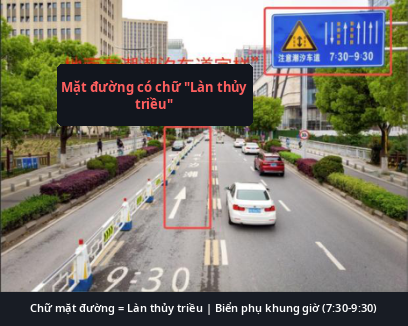
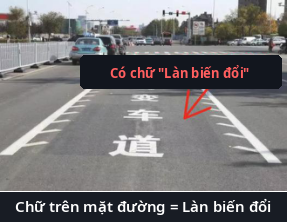
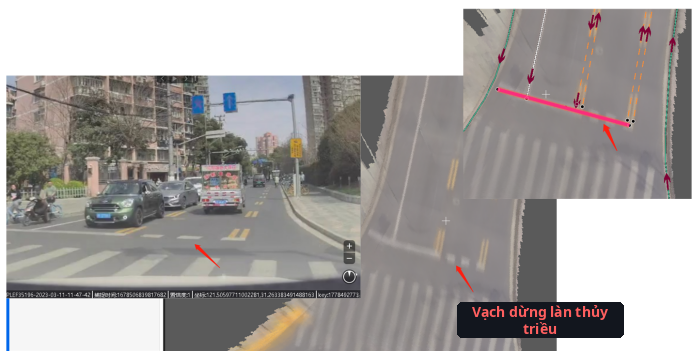
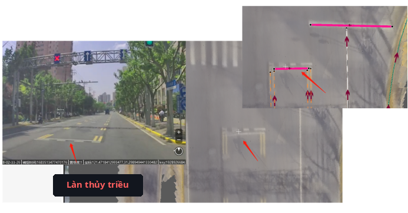

# Tài liệu bổ trợ: Giải thích thuật ngữ & các trường hợp dễ nhầm (300-10 v3.2.1)

> Tài liệu ghi chú nội bộ đi kèm bản đặc tả chính thức [`300-10-v3.2.1-vi.md`](300-10-v3.2.1-vi.md). Nội dung dưới đây nhằm giúp annotator/QC hiểu rõ bản chất thực tế và tránh nhầm lẫn khi gán nhãn, **không nằm trong file PDF gốc**.

---

## 1. Làn thủy triều (`Lane type = 1`, 潮汐车道)

### 1.1 Bản chất ngoài thực tế
Hiểu một cách đơn giản, **làn thủy triều** (*tidal lane* — ngoài đời thường gọi là **làn đường đảo chiều theo giờ**) là **một làn xe có thể đổi ngược chiều di chuyển tùy theo khung giờ cao điểm**.

Tên gọi "thủy triều" bắt nguồn từ việc lưu lượng xe lên – xuống theo hai hướng trong ngày giống như thủy triều:
- **Buổi sáng:** Dòng xe hướng **vào trung tâm** đông → làn này mở cho xe chạy theo hướng **vào**.
- **Buổi chiều:** Dòng xe hướng **ra khỏi trung tâm** đông → làn này đảo ngược cho xe chạy theo hướng **ra**.

### 1.2 Cách nhận biết trên mặt đường và ảnh camera / BEV
- **Vạch kẻ hai bên làn:** Thường là **hai cặp vạch nét đứt màu vàng song song** (vạch đôi nét đứt vàng) bọc hai bên làn.
- **Chữ sơn mặt đường & biển báo phụ:**
  - Mặt đường thường sơn chữ `潮汐车道` (*Làn thủy triều*), đôi khi có kèm mốc giờ (như `9:30` trong hình bên dưới).
  - Phía trên thường có **biển phụ khung giờ** (ví dụ `7:30–9:30`) hoặc **đèn tín hiệu trên giá long môn** (dấu `❌` đỏ cấm đi hoặc mũi tên xanh cho phép đi theo chiều tương ứng).

### 1.3 Phân biệt nhanh với "Làn biến đổi" (`Lane type = 2`)
Hai loại làn này đều thay đổi quy tắc lưu thông theo lưu lượng nhưng **khác hẳn nhau về bản chất**:

| Tiêu chí | Làn thủy triều (`Lane type = 1`) | Làn biến đổi (`Lane type = 2`) |
| :--- | :--- | :--- |
| **Thay đổi cái gì?** | Đổi **chiều chạy tới / lùi** (thuận chiều hoặc ngược chiều theo giờ) | Luôn chạy **1 chiều tới ngã tư**, chỉ đổi **hướng mũi tên rẽ / đi thẳng** (lúc cho đi thẳng, lúc cho rẽ trái) |
| **Vạch biên đặc trưng** | Hai cặp vạch **nét đứt màu vàng** song song | Vạch **răng cưa chéo** (nét gạch chéo hướng vào trong lòng làn) màu trắng |
| **Chữ mặt đường** | `潮汐车道` (*Làn thủy triều*) | `可变车道` (*Làn biến đổi*) |
| **Hình minh họa** |  |  |

### 1.4 Tóm tắt quy tắc gán nhãn trong spec
Tham chiếu chi tiết tại [`300-10-v3.2.1-vi.md`](300-10-v3.2.1-vi.md):

1. **Đường tâm làn (`Lane` — Bảng 1 & mục 2.1.1):**
   - Gán thuộc tính `type = 1` (**Làn thủy triều**).
   - Khi nối tiếp với làn thường (`type = 0`), ngắt đoạn tại vị trí đổi thuộc tính; trong đoạn nối `1 tách N` hoặc khu vực không vạch ưu tiên gán thuộc tính của làn đặc biệt (mục 2.1.1, quy tắc 8 & 10).
2. **Vạch dừng riêng của làn thủy triều (`Stopline` — mục 2.1.4, quy tắc 4):**
   - Gần nút giao, làn thủy triều thường có một vạch **nét đứt** (hoặc **nét liền + nét đứt**) nằm chắn ngang vuông góc với chiều xe chạy. Dù trông giống nét đứt chứ không phải vạch liền trắng thông thường, vẫn **bắt buộc gán thành `stopline`**.
   - **Thẳng hàng với vạch dừng thường:** Vẽ gộp chung thành **1 đường `stopline`**.
   - **Lệch bậc thang so với vạch dừng thường:** Vẽ **tách riêng 1 đường `stopline`** cho làn thủy triều.

| Trường hợp thẳng hàng (vẽ chung 1 đường) | Trường hợp lệch bậc thang (vẽ tách riêng) |
| :---: | :---: |
|  |  |
