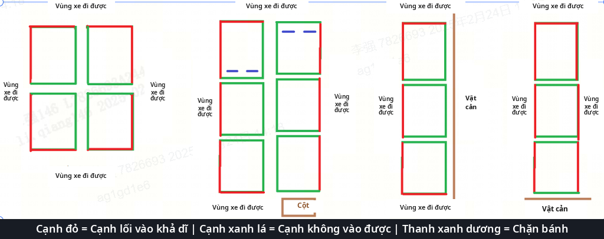

# Nhầm lẫn cạnh lối vào (`entrance_confusion`)

> Thuộc bộ [Hướng dẫn thuật ngữ](README.md) đi kèm bản đặc tả [`300-10-v3.2.1-vi.md`](../300-10-v3.2.1-vi.md).

## 1. Tại sao phải có thuộc tính `entrance_confusion`?
Theo quy tắc gán điểm góc ở mục `2.1.6.1`, mỗi chỗ đỗ xe có 4 điểm `0 → 1 → 2 → 3` theo chiều kim đồng hồ, và **cạnh `0-1` bắt buộc phải là cạnh lối vào** (cạnh mở để xe lái vào ô đỗ).

- Khi gán nhãn trên **bản đồ nền lớn (BEV)**, vị trí hiện tại của xe Ego không cố định.
- Nếu một ô đỗ chỉ tiếp giáp vùng xe đi được đúng **1 cạnh duy nhất** (3 cạnh còn lại bị bịt bởi tường, cột, thanh chặn bánh, hoặc giáp lưng/giáp hông ô đỗ khác) → xác định chắc chắn được đâu là cạnh `0-1` → gán **`entrance_confusion = 0`** (*cạnh lối vào rõ ràng*).
- Ngược lại, nếu một ô đỗ có **từ 2 cạnh trở lên đều có thể lái xe trực tiếp đi vào** (vì xung quanh các cạnh đó đều là vùng xe đi được và không có vật cản cố định) → annotator không thể khẳng định chắc chắn cạnh nào là cạnh `0-1` duy nhất → thống nhất gán **`entrance_confusion = 1`** (*chỗ đỗ nhầm lẫn cạnh lối vào*).

## 2. Đọc đúng quy ước màu trong sơ đồ minh họa (Bảng 6 & mục 2.1.6.1)
Trong cả **Bảng 6** và **mục 2.1.6.1** của PDF gốc, quy ước màu đồng nhất như sau:
- **Cạnh MÀU ĐỎ:** **Cạnh lối vào khả dĩ** — cạnh hở, tiếp giáp trực tiếp với **Vùng xe đi được** và không bị vật cản cố định chắn → xe **có thể** đi vào ô đỗ từ cạnh này.
- **Cạnh MÀU XANH LÁ:** **Cạnh không vào được** — cạnh bị chặn bởi **vật cản cố định** (tường, rào, cột), bị **thanh chặn bánh (màu xanh dương)** khóa đầu ở phía đó, hoặc **giáp lưng/giáp hông với ô đỗ khác**.

> **Quy tắc đếm nhanh:** Đếm số **cạnh đỏ** của riêng ô đỗ đang xét:
> - Cạnh đỏ **`= 1`** → lối vào rõ ràng (**`entrance_confusion = 0`**).
> - Cạnh đỏ **`> 1`** *(hoặc không xác định được cạnh nào để đi vào)* → chỗ đỗ nhầm lẫn cạnh lối vào (**`entrance_confusion = 1`**).

## 3. Lưu ý quan trọng: Khi `entrance_confusion = 1` có bỏ đánh điểm `0, 1, 2, 3` không?
**KHÔNG.** Trong mọi trường hợp (kể cả khi **`entrance_confusion = 1`**), bạn **VẪN BẮT BUỘC phải đánh đủ 4 điểm góc `0, 1, 2, 3` theo chiều kim đồng hồ**:
- Theo quy tắc `2.1.6.1-1`: *"Mỗi chỗ đỗ xe bắt buộc phải có đúng **4 điểm góc** (không được ít hơn hoặc nhiều hơn 4 điểm)"* và *"Tuyệt đối không được gán sai thứ tự điểm góc trong mọi trường hợp"*.
- Khi ô đỗ có **`> 1` cạnh đỏ**, thao tác đúng là:
  1. **Chọn 1 cạnh đỏ hợp lý** làm cạnh `0-1`, rồi đánh đủ 4 điểm **`0, 1, 2, 3`** theo chiều kim đồng hồ như bình thường *(như minh họa ở hình vector mục `2.1.6.1-2` trong PDF gốc)*.
  2. Gán kèm thuộc tính **`entrance_confusion = 1`**.

> **Ý nghĩa thật của `entrance_confusion = 1`:** Thuộc tính này **không** dùng để bỏ đánh `0, 1, 2, 3`, mà là **cờ báo cho mô hình/hệ thống** biết ô đỗ có nhiều cạnh lối vào hợp lệ, nên cạnh `0-1` vừa đánh chỉ là một trong các lối vào khả dĩ chứ không phải lối vào duy nhất.

## 4. Giải đáp các tình huống hay thắc mắc
1. **"Cạnh màu đỏ giáp vùng xe đi được" có nghĩa là xe không được vào à?**
   - **Không phải.** Trong sơ đồ của spec này, **cạnh màu đỏ mới là cạnh xe có thể đi vào**, còn **cạnh màu xanh lá** mới là cạnh bị chặn / giáp ô khác không vào được.
2. **Nếu cạnh hướng ra vùng xe đi được nhưng ngay phía đó có vật cản cố định (cột, tường, hoặc thanh chặn bánh sát cạnh) thì sao?**
   - Vật cản **cố định, không di dời được** (như cột `柱子`, tường `障碍物`, thanh chặn bánh gắn ở cạnh đó — xem hình 2, 3, 4) biến cạnh đó thành **cạnh xanh lá** (không vào được).
     - Nếu nhờ bị chặn bớt mà chỉ còn lại **1 cạnh đỏ duy nhất** → **`entrance_confusion = 0`** (ví dụ ô trên-phải và ô dưới-phải ở hình 2, hoặc các ô ở giữa của hình 2 và hình 3).
     - Nếu chặn bớt rồi mà vẫn còn **`> 1` cạnh đỏ** (như ô dưới cùng ở hình 4 bị chặn đáy nhưng vẫn mở cả bên trái và bên phải, hoặc ô trên-trái ở hình 2 bị chặn đáy bằng thanh chặn bánh nhưng vẫn mở cả trên và trái) → vẫn gán **`entrance_confusion = 1`**.
   - Nếu vật cản chỉ là vật **chắn tạm / chiếm chỗ** bên trong ô đỗ (xe khác đang đỗ, cọc tiêu di động, biển cấm đỗ, xe đẩy...) thì **không** làm đổi logic `entrance_confusion`; lúc đó xử lý bằng thuộc tính **`occupy`** (chiếm chỗ).
3. **Ở cụm 2×2 giữa bãi trống (hình 1) có tới 2 cạnh đỏ mỗi ô, nghĩa là xe đỗ vào từ cả 2 phía được à?**
   - Đúng vậy. Vì mỗi ô nằm ở góc cụm, không có thanh chặn bánh hay cột chắn, nên trên bản đồ BEV có thể hiểu là đỗ thẳng từ trên/dưới vào **hoặc** đỗ song song từ trái/phải vào — tồn tại 2 cạnh lối vào khả dĩ nên gán `entrance_confusion = 1`.
