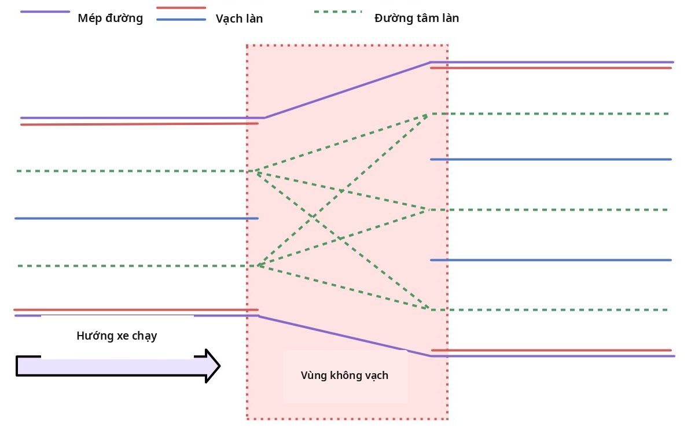
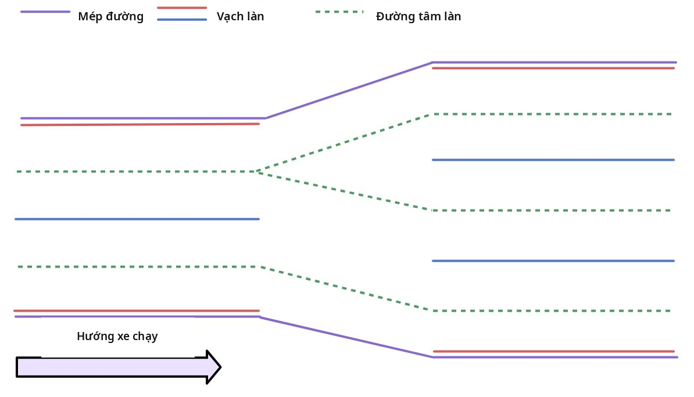

# Quan hệ topo (`topology`, 拓扑关系)

> Thuộc bộ [Hướng dẫn thuật ngữ](README.md) đi kèm bản đặc tả [`300-10-v3.2.1-vi.md`](../300-10-v3.2.1-vi.md).

## 1. Quan hệ topo là gì?
Hiểu đơn giản, **quan hệ topo** là **mối liên kết cho biết xe từ đường tâm làn phía trước được nối đi tiếp sang đường tâm làn nào ở phía sau** (*tiền bối → hậu duệ*).

- Nếu chỉ vẽ từng đoạn đường tâm làn (`Lane`) rời rạc mà không nối đầu–đuôi với nhau, hệ thống sẽ không biết khi đi hết làn A thì xe được đi thẳng, tách nhánh hay nhập sang làn nào tiếp theo.
- Về mặt thao tác gán nhãn (mục `2.1.1` quy tắc 6): khi chuyển hướng topo hoặc ngắt đoạn đổi thuộc tính, **điểm cuối của làn trước phải trùng khớp tọa độ với điểm đầu của làn sau**, đồng thời góc chuyển hướng giữa hai đoạn phải **`< 45°`**. Các dạng kết nối thường gặp gồm:
  - Đi thẳng `1 → 1` (hoặc `N → N`)
  - Tách làn `1 → N`
  - Gộp làn `N → 1`
  - Biến đổi số làn qua vùng không vạch `N → M`

## 2. Tại sao trong sơ đồ `11a` và `11b` đường tâm làn vẽ bằng nét đứt màu xanh lá?
**Đó chỉ là quy ước nét vẽ minh họa của sơ đồ trong tài liệu gốc**, không phải loại vạch sơn nét đứt ngoài mặt đường và không chỉ dùng riêng cho vùng không vạch.

Nhìn ở **hàng chú thích (legend) góc trên cùng bên trái** của hai sơ đồ:
- Nét liền tím = **Mép đường** (`Roadedge`)
- Nét liền đỏ / xanh dương = **Vạch làn** (`Border` — vạch sơn thật trên đường)
- **Nét đứt xanh lá (`- - - -`) = Đường tâm làn (`Lane`)** — toàn bộ đường tâm làn ở đoạn trái (`2` làn), đoạn giữa và đoạn phải (`3` làn) đều được vẽ bằng nét đứt xanh lá để dễ phân biệt với vạch làn thật (nét liền).

## 3. Hiểu đúng kịch bản `N sang M`: `11a` (Phía gán nhãn) vs `11b` (Phía tích hợp)
Ở mục `2.1.1` quy tắc 11 (`N ≠ M`, đồng thời cả `N` và `M` đều `> 1` — ví dụ `2` làn mở sang `3` làn qua vùng không vạch), quy trình được chia cho **2 bên** làm hai bước khác nhau:

| Khía cạnh | **11a — Phía gán nhãn (Annotator làm)** | **11b — Phía tích hợp (🔴 Pipeline xử lý, annotator KHÔNG làm)** |
| :--- | :--- | :--- |
| **Cách nối tâm làn** | **Nối đủ tất cả các cặp khả dĩ** (`2 × 3 = 6` đường chéo ở đoạn giữa) vì vùng này không có vạch kẻ phân làn | **Xóa các nhánh chéo không tối ưu**, chỉ giữ lại các nhánh thuận chiều hợp lý (làn trên tách `1 → 2` sang trên & giữa; làn dưới nối `1 → 1` sang dưới) |
| **Thuộc tính đoạn giữa** | Gán **`type = 7`** (*Làn khu vực không vạch*) | **Xóa** thuộc tính `type = 7` |
| **Trạng thái đoạn nối** | **Ngắt đoạn** tại hai mép vùng không vạch (trái & phải) | **Gộp thành chuỗi dài liên tục (*long instance*)** từ đoạn trước → giữa → sau |
| **Sơ đồ minh họa** |  |  |

> **Tóm tắt cho người gán nhãn:** Khi gặp kịch bản `N sang M` (`N, M > 1`) qua vùng không vạch, bạn làm đúng theo **11a** (nối đủ mọi cặp khả dĩ, ngắt đoạn ở hai mép vùng không vạch, gán `type = 7` cho đoạn nối ở giữa); việc tỉa nhánh và gộp thành instance dài ở **11b** sẽ do phía tích hợp dữ liệu tự xử lý sau.

## 4. Các ràng buộc topo cần nhớ trong spec
Theo mục `2.1.1` của [`300-10-v3.2.1-vi.md`](../300-10-v3.2.1-vi.md):
1. **Làn khẩn cấp (`type = 3`)** **không** kết nối topo với bất kỳ loại làn nào khác.
2. **Làn xe cơ giới** **không** kết nối topo với **làn xe phi cơ giới (`type = 4`)**.
3. Khi làn đặc biệt nối với làn thường (`type = 0`), đoạn nối ưu tiên mang thuộc tính **làn đặc biệt**; nếu trước và sau đều là làn đặc biệt thì đoạn nối mang thuộc tính của **làn kế tiếp (phía sau)**.
4. Khi đường mở rộng đạt độ rộng **`>= 6 m`** (quy tắc 9): chia đều theo chuẩn `3 m` mỗi làn kể từ điểm ổn định độ rộng, rồi kết nối topo `1 tách N` từ làn trước sang các làn đã chia (nếu `< 6 m` thì chỉ nối `1-1`).
